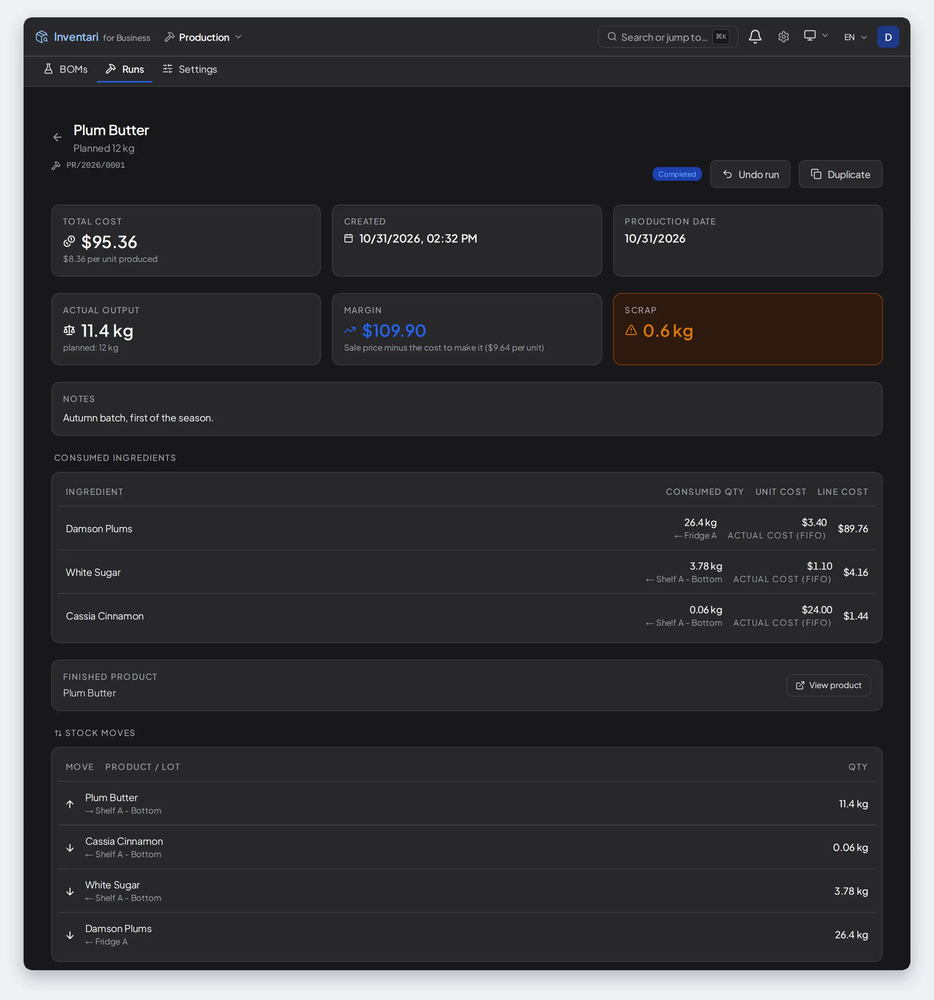

<div align="center">


<br/><br/>

# Inventari

### Use Inventari. Build on Inventari.

**A self-hosted inventory app that tells you what you have and where it is — for your home or your small business — on a shared core you can build your own applications on.**

<br/>

[**Try the demo**](https://demo.inventari.app) · [**Quick Start**](#quick-start) · [**Build on Inventari**](#build-on-inventari) · [**Screens**](#what-it-looks-like) · [**Modules**](#modular-architecture) · [**Docs**](docs/README.md) · [**CLI**](docs/CLI.md) · [**Contributing**](CONTRIBUTING.md) · [**Security**](SECURITY.md)

<br/>

![A small wholesaler's warehouse at work on the desk and on the phone. On the desk, the work board: three cards to do — Sam Okafor's own card to wrap the pallet for Northside Grocers, their order to pick and a delivery from Ortolana Imports to receive — two orders being picked by Priya Nair, and four done this morning between 08:01 and 10:11, the two receipts and the two orders shipped to Harbour Street Deli and The Copper Kettle Café. On the phone, the same picking walk: take ten packs of Arborio rice from shelf B-01-03, with the camera open and aimed at the barcode on the carton](docs/images/warehouse-desk-and-phone.webp)

</div>

<br/>

Inventari follows what you own through every move it makes — received, issued,
moved, consumed, counted — and tells you where each thing sits right now. It
keeps one record of things, places, stock movements, organizations and
permissions, and each module adds the screens and rules for one job.

Use the included modules to run a kitchen, track equipment, make products or
operate a warehouse. Build your own module when your work needs a different
process, or extend an existing module through its public interfaces.

The included applications show both the range and the depth of that model:
meal planning and equipment custody share the same core, while the warehouse
module runs receiving, picking, packing and shipping.

**Alpha release:** best for small teams today, with occasional breaking changes
between releases — see [Alpha Release v0.11.0](#alpha-release-v0110).

**Use Inventari:** [try the demo](https://demo.inventari.app),
[run it locally](#quick-start) or [deploy it on your server](QUICK_DEPLOY.md).

**Build on Inventari:** [see what a module can do](#build-on-inventari),
[create your first module](MODULE_QUICKSTART.md) or
[extend the warehouse](examples/lot_certificates/README.md).

**Contribute to Inventari:** [work on the platform or its included modules](CONTRIBUTING.md).

The demo is public and needs no account: one click gives you an organization
of your own, already stocked, and every night it is wiped — so put nothing
real in it. The banner over every screen has **Label sheet**: one A4 of that
copy's shelf and product codes to print and scan with a phone — receive
goods, put them away, pick them again — before you set up a warehouse of
your own.

---

## Why Inventari?

A workshop may need to buy materials, make a batch, track its cost, issue the
finished goods and keep tools assigned to people. A kitchen may need expiry
dates, recipes and shopping lists. Each workflow uses some of the same facts:
what exists, where it is and what changed.

Inventari keeps those facts in a shared core. Modules supply the vocabulary,
rules and screens for each job, and an organization enables the modules it
uses.

**For Home** — stop throwing away expired food, cook from what you already
have, and scan a label instead of typing it.

**For IT** — laptops, monitors and phones with serials, warranties,
maintenance and who signed for what. QR labels for every asset.

**For Business** — goods received, goods dispatched and internal transfers as
numbered documents, with stock moved for you; goods received and picked with a
phone's camera, several deliveries in one walk along the warehouse's route,
then packed and shipped with the carrier's tracking number; purchase orders
matched against deliveries; stock takes that check the system against the
shelf; FIFO valuation of what leaves.

**For Makers** — bills of materials, production runs that take the materials
off the shelf and put the product on it, and what every batch cost, from the cost layers its components came from.

## Build on Inventari

Your module defines the concepts and processes of your field. It can own
tables and migrations, expose an API, add screens and permissions, run
background work and participate in stock operations. CoreAPI supplies the
shared data and operations; the module SDK and frontend extension points
connect your application to the rest of Inventari.

The included modules show how different those applications can be. Recipes
work with ingredients, cooking and meal plans. Equipment follows an
individual asset through handovers, returns and maintenance. Production
consumes components, creates finished goods and records their cost.

### How deep a module can go

The warehouse module is a light warehouse management system. It owns
numbered documents and their lifecycle, receiving and picking sessions,
putaway rules, packages, shipping records, corrections and closed periods.
Its screens serve both the person handling goods on a phone and the office
that needs the document behind each movement.

This is the platform's largest module. Its data, documents and stock reads go
through the public contracts, CoreAPI and module SDK; some helpers (barcodes,
printing, import sheets, money) are still internal to this repository, so a
package of your own cannot copy it as it stands. Read its source,
[Warehouse](backend/app/modules/warehouse), to see how a substantial
application is organised, and start from the example below for code to copy.

### Extend an application for your work

A module can also add a specialised workflow to an existing application.
The [Lot certificates example](examples/lot_certificates/README.md) adds
certificate fields to receipt lines, blocks a receipt until the required
certificate is on file, supplies a picking order and adds a column, filter
and action to the document list. It has its own table and migration chain
and connects through the warehouse's public extension points.

### Start with a generated package

From a running Inventari development environment:

    make new-community-module NAME=my_workflow

The generator creates a separate package with backend and frontend code,
manifests, a model and migration, an example API endpoint and screen, and
translation catalogs. You develop the process your users need in that
package and install it into Inventari.

[Create your first module](MODULE_QUICKSTART.md) ·
[Explore the module API](MODULES_GUIDE.md) ·
[Read the module licensing terms](MODULE_LICENSING.md)

Modules integrate through documented extension points. A workflow that
needs a new extension point starts with a proposal to add it. The
[compatibility policy](docs/subsystems/CONTRACTS_STABILITY.md) identifies
which interfaces are stable and which are experimental in 0.11.

---

## How it compares

If you need a ready-made application, compare the workflows the included
modules provide. If you are building an application, also consider what
your module can own, which operations it can extend and which shared
services you can reuse.

The table below compares the included functionality. The examples in
[Build on Inventari](#build-on-inventari) show the extension model.

| | Inventari | Grocy | Snipe-IT | InvenTree | Sortly | Homebox |
|---|:--:|:--:|:--:|:--:|:--:|:--:|
| Self-hosted | ✅ | ✅ | ✅ | ✅ | — | ✅ |
| License | AGPL-3.0 | MIT | AGPL-3.0 | MIT | proprietary | AGPL-3.0 |
| Expiry dates & alerts | ✅ | ✅ | licence and warranty expiry, daily alert emails | expiry dates; stale-stock emails (opt-in) | custom date field + alerts (Ultra plan and up) | — |
| Recipes & meal planning | ✅ | ✅ | — | — | — | — |
| IT assets, check-out & maintenance | ✅ | — | ✅ | — | basic | basic |
| Numbered warehouse documents (GRN · DN · transfer) | ✅ | — | — | orders: purchase · sales · return · transfer | — | — |
| Purchase orders | ✅ | — | — | ✅ | Ultra plan and up | — |
| Supplier records | ✅ | stores only (name, description) | ✅ | ✅ | vendors, with purchase orders (Ultra plan and up) | free-text field |
| Bills of materials & production runs | ✅ | recipes only: cooking books one product | — | ✅ | folders as a manual kit list | — |
| FIFO removal from cost layers | ✅ | price per stock entry; consumed from the default location, then opened stock, then earliest due date | — | purchase price per item; FIFO/FEFO pick order, no cost layers | — | — |
| Product recognition from a photograph | ✅ | — | — | — | — | third-party only |
| Third-party module system | ✅ | barcode-lookup plugins only | — | ✅ | — | — |
| Multi-organization tenancy | ✅ | — | companies (shared catalog) | — | separate accounts, one login (Enterprise plan) | collections |
| Single sign-on (LDAP · SAML · OIDC) | — | LDAP | LDAP · SAML | ✅ | Enterprise plan | OIDC |
| Native mobile app | — | community apps (Android · iOS) | official app in beta · third-party apps | ✅ | ✅ | third-party only |

The table counts built-in features; where one is not — behind a paid plan,
still a beta, or shipped by a community or third-party project — the cell says
so. "—" means neither the project's code nor its documentation shows one.
Homebox is the maintained fork, sysadminsmedia/homebox; the original project has
had no release since January 2024.

The last two rows are where Inventari is behind: it signs people in with its own
accounts only, and on a phone it runs in the browser rather than as an app.

**InvenTree** is a close alternative for parts, assemblies and manufacturing,
with suppliers, stock locations, orders and plugins. Compare the actual
workflow you need in both applications. Inventari also provides kitchen and
equipment workflows on its shared core, and makes that core available to
authors building applications for other fields.

**Odoo and ERPNext** cover a wider business scope, including accounting, CRM
and manufacturing; their inventory apps reach further than this one does, into
multi-company flows and, in Odoo, routes between locations. If what you need is
an ERP, take one of them; Inventari is not a smaller ERP and is not trying to become one. What it offers
a small business is a light start: it comes up with one command, there is no
chart of accounts to configure before the first product goes in, and barcode
scanning is in the box rather than behind Odoo's Enterprise edition — where
Community users add it back with third-party apps such as the OCA's Shopfloor
modules. You can use its included applications or build a workflow for your
field on the same foundation.

Choose against the process you need today: the included warehouse and
production modules have explicit boundaries, described in their
[purpose cards](docs/purpose/README.md).

Landed costs work here too, with one boundary: Odoo can apply freight, duty and
insurance to a receipt after it is validated, adding to the valuation layers the
receipt already created and posting the difference, while Inventari only
spreads them over a delivery that is still open — it has no general ledger to
book the difference to afterwards.

The rows above are compiled from each project's own code and documentation,
October 2026, and they will go stale. If one is wrong, it is a bug like any
other — please [open an issue](https://github.com/InventariLabs/Inventari/issues/new).

---

## What it looks like

Every screen below is the running application at twice the usual pixel
density. They come from two places.

The warehouse, the labels, the statistics and the phone are one small
business: Larkspur Trading Co., a fine-food wholesaler in Melbourne with two
aisles of racks, four suppliers and a handful of cafés, delis and grocers as
customers. It was set up through the onboarding wizard as *Equipment &
Warehouse*, and its Saturday morning was entered through the application's own
API — two deliveries received, two orders picked, packed and handed to DHL,
two more being picked in one walk. The application stamps every entry with
the moment it was made, and the morning was entered in one sitting, so those
stamps were afterwards moved, in the order they were made, onto the hours
between 07:44 and 10:35. That is the only change made outside the application;
the label sheet is the labels the application printed, laid out on one page.
The same morning can be entered by hand in any installation.

The IT desk, the kitchen, the workshop and the module store are the demo seed:
what `make demo-reset` builds and the [public demo](https://demo.inventari.app)
shows every visitor, signed in as its administrator and not changed in any
way. The [gallery](docs/GALLERY.md) has the rest of both, module by module.

### The warehouse: numbered documents that move stock

Receipts, dispatches, transfers and corrections as numbered, registered
documents, each one moving stock and leaving a trail — from draft to confirmed
to done, line by line. On the floor the same documents are received and picked
with a phone's camera, packed into numbered packages and handed to a carrier
with a tracking number.


**A shipped delivery** — who wrote it, who confirmed it and who sent it, the
carrier and the tracking number that opens the carrier's page, and every line
with the shelf it came off.


**Occupancy** — the whole floor at a glance: which shelves have room, which
are nearly full and which are over the limit putaway works to.

### Labels on every shelf

In a business every location has a code that follows the rack and level
(`A-01-02`), and the **Codes and labels** screen prints a label for each: the code in bars for a
USB or Bluetooth scanner and as a QR code for a phone camera.


### Statistics


### Beyond the warehouse

The same core under an IT desk, a kitchen and a workshop — three of the
modules the demo seed switches on beside the warehouse.


**Equipment** — what needs attention first, then the whole fleet by category;
serials, warranties, maintenance and who signed for what are a click below.


**A recipe** — which ingredients are in the house and where each one is; the
missing ones go onto the shopping list.



**A production run** — what went in at its FIFO cost, what came out, and every
shelf it touched.

### One core, many workspaces

Modules are switched on per organization, each with its version and what it
touches on the server. What you do not switch on, you do not see: the
wholesaler above runs the business modules its launcher shows, the demo almost
all of them.


### In the dark


### A phone that is not an afterthought

The app is designed for the phone first: the phone layout is the primary one
rather than a narrowed table.

| | | |
|---|---|---|
|  |  |  |
| **Start** — the day's work for the person holding the phone. | **Picking several orders at once** — one walk in the warehouse's order, every line naming the order it is for. | **The launcher** — the modules this business runs, with what waits in each. |

---

## Features

- **Stock** — a tree of locations of any depth, records with expiry and freeze
  dates, batches with a state (active, quarantined, recalled…), stock takes, a
  journal of every movement, stock as it stood on a past date, and QR labels
  for products and locations.
- **Kitchen** — recipes that know what is on the shelf and where, a weekly
  meal planner, shopping lists, and nutrition from Open Food Facts.
- **Equipment** — serials, warranties, check-out to people with handover
  protocols, maintenance, attestation campaigns and depreciation.
- **Warehouse** — receipts, deliveries, transfers and corrections as numbered
  documents; receiving and picking with a phone's camera (a USB or Bluetooth
  scanner is supported, not yet tried with real hardware), several deliveries
  in one walk along numbered locations; packing into packages with slips and
  labels; shipping with carrier and tracking number; purchase orders received
  in part or in full; putaway rules; closed periods; approval workflows; FIFO
  valuation.
- **Production** — bills of materials, production runs and the cost of each
  batch.
- **Photo recognition** — a product read from a photograph of its label.
- **Around it** — several organizations on one installation, custom roles,
  webhooks, API keys, a REST API with OpenAPI docs, five maintained
  languages (EN · PL · DE · FR · ES) and a Brazilian Portuguese community
  translation, and a phone-first interface with dark mode.

The [User Guide](docs/USER_GUIDE.md) walks through every one of them, screen by
screen.

### Product recognition from a photograph

Point a camera at a label and Vision AI fills in the name, expiry, weight and
nutrition. The provider is configured per organization — Gemini, OpenAI,
Anthropic, any OpenRouter model (Qwen among them), or a local model through
Ollama, so the photographs need never leave your machine.

Ten hosted and eight local models were measured against the same fourteen
real product photographs through the application's own code path. The
recommended `google/gemini-3.5-flash-lite` read 32 of 32 fields and invented
none, at a median 1.4 s and under a dollar per thousand photographs;
`qwen3-vl:8b` through Ollama read 28 and invented one. The corpus is
deliberately full of labels that show no net weight, because a model that
supplies one anyway is reciting a catalogue rather than reading your shelf.

Full matrix, local table, cost per model and every failure with what the
provider actually said:
[`docs/subsystems/VISION_AI.md`](docs/subsystems/VISION_AI.md).

### Locations that match the building

A tree of locations of any depth — the structure is the parent link alone,
with no named levels, shown as a path such as `Home › Garage › Shelf A`. Products
may sit in any node, not only at the leaves. Virtual locations track lifecycle:
used, disposed, produced.

### Warehouse documents that carry your vocabulary

The warehouse module defines eight neutral codes — `IN`, `OUT`, `INT`,
`INTERNAL_IN`, `INTERNAL_OUT`, `CORRECTION`, `ADJUSTMENT`, `SCRAP`. What they
are *called* on screen and in a document number belongs to the profile you
pick: "PL Magazyn" labels them PZ, WZ, MM, PW and RW; "UK Warehouse" labels the
same documents GRN, DN, ST, IPR and IC; "DE Lager" WE, WA, UML, IE and IV;
"FR Entrepôt" uses BR, BL, BT, ERI and SCI, and "ES Almacén" AE, AS, TR, EI and
SI. A profile with no labels leaves the
neutral codes in place.

### Labels

Unique `STM-XXXX` QR codes for products — the prefix is chosen when a batch of
labels is generated — and a code for every location. In a business the codes
follow the location tree: a letter for the first level under a warehouse, then
two-digit numbers (`A-02-01`), from a template each warehouse can change. At
home, where a shelf has no aisle or rack to number, a code is drawn at random
(`LOC-7KQ2`). Renaming a location never changes its code. Labels download as
images for any printer, or print through the
[print agent](print-agent/), which drives a Brother P710BT, a CUPS queue, or
any command you point it at.

### Analytics

Expiry forecasting, stock age and rotation, alerts for forgotten products,
missing staples and price spikes, a spending forecast, and a reconciliation
that checks the shelves against the movement journal and the quantities the
cost history holds against the shelves. Stock is valued FIFO: what leaves takes the
oldest cost first.

### Privacy

100% self-hosted; no telemetry and no external calls without explicit consent.
Each organization controls its own AI provider and model. AGPL v3: if you run a
modified version as a network service, you publish the source.

---

## Modular Architecture

Core owns the shared inventory concepts and operations. Modules own their
domain data, rules and screens. These are the applications and services
included with Inventari; [Build on Inventari](#build-on-inventari) explains
how to add your own.

### Warehouse and business
| Module | Description |
|---|---|
| **Warehouse** | Receive, issue, move and count stock — goods are received and picked with a phone's camera, several dispatches in one walk, packed into packages and shipped with a tracking number, and the numbered, registered documents behind each move are written in the background — with putaway rules |
| **Purchase Orders** | Orders to suppliers, received in part or in full, with the goods receipt generated from the order |
| **Stock Takes** | Periodic checks of the system against the shelf |
| **Production** | Production runs, bills of materials (BOM) and cost rollup |
| **Approvals** | Multi-stage configurable approval workflows |
| **Partners** | Suppliers, customers and service providers for B2B workflows |

### Kitchen
| Module | Description |
|---|---|
| **Recipes** | Recipes with ingredient availability checking and scan-to-pick mode |
| **Shopping Lists** | Shopping lists filled by hand, from recipes and meal plans, or from what is running low |

### Equipment
| Module | Description |
|---|---|
| **Equipment Tracking** | IT and physical assets with lifecycle management |

### Integrations
| Module | Description |
|---|---|
| **API Keys** | Personal access tokens for machine-to-machine authentication (Home Assistant, Make, n8n, Zapier, custom scripts) |
| **Webhooks** | Outbound HTTP notifications for inventory events |
| **Label Printing** | Label pool management and QR and barcode PNG generation, printed through the print agent |
| **Nutrition Info** | Enriches product data from Open Food Facts |
| **Photo Recognition** | Recognizes products from photographs using AI |

### Analytics
| Module | Description |
|---|---|
| **Statistics** | Consumption analysis and waste tracking |

**Statistics** and **Label Printing** ship always-on and cannot be switched off
from the launcher. **Partners** has no backend module directory — its API is served by the
core — but it does have a frontend module (`frontend/src/modules/partners`),
and it switches on and off like any other.

The [module guide](MODULES_GUIDE.md) documents ownership and access to Core.
The [advanced guide](docs/MODULE_ADVANCED_GUIDE.md) covers events, operation
checks and extensions to existing modules.

### How it is checked

The boundaries above are enforced by tools rather than asked for in a style
guide:

- **A contract for modules.** Modules reach the core through CoreAPI — over 30
  namespaces and over 250 methods with typed inputs and outputs. A snapshot
  test fails on any change to it that is not purely additive, and a deprecated
  method carries the release it will be removed in, which a test holds it to.
- **An architecture lint** of dozens of checks runs on every commit: which
  module may import what, who owns a transaction, migrations kept with the
  module that owns their tables, a read-modify-write without a row lock.
- **Tests.** Over 14,000 backend tests, over 11,000 frontend unit tests and over
  800 end-to-end browser tests. The backend suite fails below 70% line
  coverage, and a change has to cover at least 80% of the lines it touches.
- **Types end to end.** mypy reports zero errors across the backend, and the
  frontend's TypeScript types are generated from the OpenAPI schema, with a
  check that fails when the two drift apart.
- **An audit log the application cannot rewrite.** Updates and deletes on it
  are refused by a trigger in the database, not by application code.
- **Measured at warehouse scale.** On a 4-core VPS with 8 GB of memory (about
  7 EUR a month), an organization of 100 000 products and 300 000 records fits
  in a 1.5 GB database: scans, record cards and a shelf's stock answer in
  20–80 ms, a page of products in under a quarter of a second, the statistics
  in under a second (the reconciliation and stock as of a date in two to
  three), and a 200-line receipt is written in 1.4 s. Posting a large receipt
  still takes about twelve seconds; [the report](docs/SCALE_REPORT.md) has
  every figure and its cause.

---

## Quick Start

### Prerequisites
- [Docker](https://docs.docker.com/get-docker/) & [Docker Compose](https://docs.docker.com/compose/install/)
- `make`, `curl` and `openssl` — the one-command bootstrap (`make dev-up`) needs all of them: it generates `.env` secrets with `openssl` and verifies the running app with `curl` (`git` is only what the clone below needs)
- An API key of your AI provider — [OpenRouter](https://openrouter.ai) is the default *(optional — only needed for AI label scanning)*

The path is developed and tested on Linux. On Windows it runs under WSL2 —
where `make` and `openssl` live — and macOS is untested.

### 1. Clone

```bash
git clone https://github.com/InventariLabs/Inventari.git
cd Inventari
```

### 2. Run

```bash
make dev-up
```

That's it — there is no `.env` to write first. `make dev-up` is the one-command
bootstrap: it generates a development `.env` with fresh secrets, builds the
containers, runs core and module migrations, seeds system data, creates the
default admin account, and then **waits until the app actually answers** before
it reports success. Run `make help` to see all available commands.

> **Bringing your own `.env`?** `dev-up` generates one only when the file is
> absent, and leaves yours untouched otherwise. So if you write it yourself,
> you own all of it: generate `SECRET_KEY` and `FERNET_SALT` with
> `openssl rand -hex 32` each. The placeholders shipped in `.env.example` are
> refused outside debug mode, and so is a known weak or short `SECRET_KEY`;
> set `DEBUG=true` too, or the backend starts in production mode and refuses
> to boot. For a real
> deployment do exactly that, from
> [`.env.production.example`](.env.production.example) — see
> [QUICK_DEPLOY.md](QUICK_DEPLOY.md).

**Optional — AI label scanning.** Put the API key of your AI provider
into `.env` as `LLM_API_KEY=...` and run `docker compose up -d backend`.
Everything else works without it. OpenRouter is the default; for DeepSeek,
MiMo, OpenAI or another provider set `LLM_PROVIDER` and `LLM_API_BASE_URL`
as well — the examples are in `.env.example`.

> 💡 **Label printing:** if you have a Brother P710BT (or similar) label printer, see [`print-agent/`](print-agent/) for the standalone print agent setup. The main app does not need printer configuration.

To fill the database with the demo's dataset — products, suppliers,
documents, equipment and a location hierarchy — run `make db-seed-demo`.
`make demo-reset` wipes the database first and adds what a visitor of the
public demo sees on top: recipe photographs, printed labels, an order waiting
for approval (see [`docs/DEMO.md`](docs/DEMO.md)). The README's IT desk,
kitchen and workshop screens come from it; its warehouse screens come from a
wholesaler entered through the application
([What it looks like](#what-it-looks-like)).

| Service | URL |
|---|---|
| **App** | http://localhost:5173 |
| **API Docs** | http://localhost:8005/docs |
| **Mailhog** | http://localhost:8025 |

Dev email goes to Mailhog rather than leaving the machine — `make dev-up` writes
`SMTP_HOST=mailhog` into the generated `.env`. To send through a real server,
point `SMTP_HOST`/`SMTP_PORT` in `.env` at it (587 for STARTTLS, 465 for TLS), or
configure SMTP per organization in the app's settings, which takes precedence.

### 3. First Login

A default admin account is pre-created on first launch. `make dev-up` prints its
email and password when it finishes — that line is the source of truth, and the
password comes from `DEV_ADMIN_PASSWORD` in the `Makefile`, so overriding the
variable changes both the account and what is printed. Log in at
http://localhost:5173.

The first login opens a short setup: pick a workspace mode, name the
organization and tick the modules to start with. It ends on the launcher —
except under **Just one module**, where you name the module instead of ticking
a list and the setup ends inside it — and none of the choices is final.

**Change the password immediately in production deployments.** The admin user
has full access; from there you can add locations and products, and enable
modules from the launcher. The [User Guide](docs/USER_GUIDE.md) takes it from
the first login onwards.

---

## Development

### Tech Stack

| Layer | Technology |
|---|---|
| **Backend** | FastAPI · SQLAlchemy 2.0 · Alembic · PostgreSQL · Valkey (Redis protocol) |
| **Frontend** | React 18 · TypeScript · Vite · TailwindCSS · React Query |
| **AI** | OpenRouter API (Gemini, Qwen, Claude, GPT-4o, …) or a local model via Ollama |
| **Infrastructure** | Docker · Nginx · Caddy (production) |

### Running it outside Docker

Two terminals, each starting from the repository root:

```bash
# Terminal 1 — the backend (uv manages its dependencies)
cd backend
uv sync
uv run uvicorn app.main:app --reload --port 8005
```

```bash
# Terminal 2 — the frontend
cd frontend
npm install
VITE_BACKEND_TARGET=http://localhost:8005 npm run dev
```

Point `DATABASE_URL` and `REDIS_URL` at the ports the dev stack publishes —
5433 for Postgres, 6380 for the cache. `VITE_BACKEND_TARGET` is there because
the Vite proxy otherwise targets the Docker hostname `backend`. Ports 8005 and
5173 are the ones the Docker stack publishes too, so stop the containers you
are replacing first: `docker compose stop backend frontend`.

Uploads go to `/app/uploads` inside a container; on a host with no `/app` the
backend uses `backend/uploads` instead, so nothing else needs setting. Set
`FILE_STORAGE_LOCAL_PATH` to put them elsewhere.

> **Changed backend dependencies?** Inside Docker the dependencies install
> into the container's Python at *build* time, so a restart is not enough —
> `docker compose restart backend` comes back with the old lockfile still
> installed and the app drifts from `uv.lock` quietly. Rebuild instead:
> `docker compose up -d --build backend`.

### Useful Make Commands

```bash
make test              # Run all tests in Docker
make test-integration  # tests/integration only — module-local integration tests come with make test
make format            # Format code (ruff + prettier)
make lint              # Check code style
make db-migrate m="description"  # Generate DB migration
make db-upgrade        # Apply pending migrations
make shell             # Interactive Python shell with DB session
```

### Management CLI

The application's own administration commands live in `backend/manage.py`
— migrations, seeding, admin accounts, module install and upgrade,
architecture linting, dependency licence checks, data backfills,
re-encrypting stored secrets after a key rotation, the demo reset, QA
fixtures and an interactive shell. What is not part of the application —
starting the stack, formatting, the test suites, the backup key pair — is
a `make` target (`make help` lists them).

**[Full CLI reference →](docs/CLI.md)**

---

## Testing

```bash
# The whole suite, with four workers
docker compose exec backend uv run pytest -n 4 -q

# One file
docker compose exec backend uv run pytest -n 4 tests/integration/test_items_api.py -q

# Frontend
docker compose exec -T frontend npx vitest run
docker compose exec -T frontend npx tsc --noEmit
```

`-n` is the number of parallel workers; a few per core is a good start.
Prefer a number to `-n auto`: the containers have no CPU limit, so `auto` takes
every core on the host. The `make` targets work the number out with
`scripts/test-workers.py`: four workers per core, at least 1 and at most 12
(the point past which more workers stopped paying off on the 24-core machine
the project is developed on), and no more than the free memory holds, a
gigabyte each. They
take an override: `make test-coverage PYTEST_WORKERS=2`. For a shorter run,
narrow the *selection* (a file, `-k <expr>`) rather than the worker count.

These runs are the checks a contribution is judged by. The workflow
(`.github/workflows/ci.yml`) runs the same suites on every push and pull
request to `dev` and `main`, but it reports after the push; it does not
replace the local gate, which is run before the push — `make test-coverage`,
`docker compose exec -T frontend npx tsc --noEmit`,
`docker compose exec -T frontend npx vitest run --coverage`, and then `make lint` and `make check-frontend`
(`AGENTS.md`, *The Mandatory Gate*, repeated in
[CONTRIBUTING.md](CONTRIBUTING.md#-development-workflow)).

---

## Contributing

### Ways to contribute
- **[Report a bug](https://github.com/InventariLabs/Inventari/issues/new?template=bug_report.md)**
- **[Request a feature](https://github.com/InventariLabs/Inventari/issues/new?template=feature_request.md)**
- **[Add a translation](CONTRIBUTING.md#-translations)** — help us reach more users
- **[Build a module](MODULE_QUICKSTART.md)** — a package of your own, or a module for this repository
- **[Fix an issue](https://github.com/InventariLabs/Inventari/issues?q=is%3Aissue+is%3Aopen+label%3A%22good+first+issue%22)** — start with the `good first issue` tag

**[Read the full Contributing Guide →](CONTRIBUTING.md)**

> **Pro tip:** the module system is the best entry point for contributors — you
> can add substantial features without touching the core codebase.

### Development Principles

1. **Mobile-first** — every screen is designed for the phone first, then widened for the desk
2. **Privacy-first** — no telemetry, no external calls without explicit user consent
3. **Module-everything** — new features go into modules, not core
4. **i18n-always** — all user-facing text goes through the translation system
5. **Domain-neutral core** — the core engine serves all verticals equally

This project follows the
[Contributor Covenant Code of Conduct](CODE_OF_CONDUCT.md).

---

## Production Deployment

`docker-compose.prod.yml` brings up the stack behind Caddy with automatic
HTTPS, daily backups of the database and the uploaded files (7 daily, 4
weekly, 6 monthly), reproducible rebuilds through `make deploy`, and
application-level rate limiting on the login, AI and vision endpoints.

**[Read the Deployment Guide →](DEPLOYMENT.md)**

---

## Alpha Release v0.11.0

Inventari 0.11.0 is an **alpha** release so that people can get to know the
product. The weeks after release go to technical debt rather than new
features. The three debts named for them were paid before the release, so
0.11.0 ships them as its contract: every collection is a page
(`items`, `total`, `limit`, `offset`, `has_more`, or `next_cursor` on the
cursor feeds, with the deliberate exceptions marked beside their routes),
business refusals carry machine-readable codes, and API keys have their own
header, permissions per key and permission-bound scopes. These three are
stable from 0.11.0. The rest of the REST API is **experimental** in 0.11: its
routes and bodies still follow the screens they serve. Contract DTOs, stable
`core_api` namespaces, the module manifest and the webhook envelope have
compatibility guards and are the surfaces to build on.
The [compatibility policy](docs/subsystems/CONTRACTS_STABILITY.md) lists every
public surface, its class and the promise that class makes; the
[error-response contract](docs/api/ERRORS.md) is the one page a client needs
for the `detail` envelope and its codes.

**Production use:** suitable for small teams willing to accept occasional
breaking changes between alpha releases. For enterprise use, wait for v1.0.

---

## What's next

0.11 makes the warehouse documents a light warehouse management system: a
phone's camera on receiving and picking, several dispatches picked in one
walk, packing and shipping with a tracking number. What it deliberately leaves
out is where the work goes next — modules that talk to a carrier (buying its
label, reading the parcel's status back), a returns process with authorisation
and inspection, and waves that group dispatches by route or cut-off time. If
you run a small warehouse and want a say in any of it,
[open an issue](https://github.com/InventariLabs/Inventari/issues/new?template=feature_request.md)
— that is where the work is discussed.

---

## License

Inventari is released under the
**[GNU Affero General Public License v3.0](LICENSE)**.
Copyright (C) 2026 Jerzy Piątek

- ✅ Free to use, modify and distribute
- ✅ Commercial use allowed
- ⚠️ Modified versions must also be AGPL-3.0
- ⚠️ Running a modified version as a network service obliges you to publish the source

Inventari is provided "as is", **without any warranty** — not even the implied
warranty of merchantability or fitness for a particular purpose — and without
liability for damages arising from its use. See sections 15 and 16 of the
[licence](LICENSE).

Food, allergen and nutrition data in Inventari — recipe allergens suggested from
ingredient names, nutrition from product labels, Open Food Facts (a community
database) or generic ingredient values — are an aid, **not a guarantee**.
Whoever enters the data and serves or sells food on it is responsible for it:
check it against each product's label. The app gives no dietary or medical
advice.

**Building a module?** Modules that stay inside the public extension points
(CoreAPI, module registry, frontend slots) may carry **any licence you like**,
including proprietary — the copyright holder grants that permission explicitly
under AGPL-3.0 §7. See [MODULE_LICENSING.md](MODULE_LICENSING.md).

---

<div align="center">

If Inventari is useful to you, **[star the repo ⭐](https://github.com/InventariLabs/Inventari)** — it helps other people find it.

**Built by [Jerzy Piątek](https://github.com/jerzypiatek)**

[Report a bug](https://github.com/InventariLabs/Inventari/issues) · [Request a feature](https://github.com/InventariLabs/Inventari/issues/new?template=feature_request.md) · [Join the Discussion](https://github.com/InventariLabs/Inventari/discussions)

</div>
