# Entity Relationship Diagram

Data model for Inventari. The diagram covers the **core schema plus documents,
purchase orders, stock takes and approvals**: every table of the core models
and of the `warehouse`, `purchase_orders`, `stock_takes` and `approvals`
modules is either drawn below or named, with the file that describes it, under
*Tables deliberately not drawn*. The other module-owned areas (equipment,
maker, recipes, nutrition, webhooks, …) are not drawn here — their tables live
in module migrations, and `docs/subsystems/MIGRATION_OWNERSHIP.md` lists which
table belongs to whom. Shopping lists are drawn only because the core
references them.

The end of a line at the parent says whether the row on the other end can go
without one: `||` means exactly one (the foreign key is `NOT NULL`), `|o` means
zero or one (the key can be `NULL` — a system-wide storage type has no
organization, a stock movement no source shelf).

A solid line is a foreign key in the database. A **dotted line** is a soft
reference: a plain id column that names another table's row without a foreign
key, on purpose, because the two tables belong to different modules (or one
column serves several target types). `tests/unit/test_the_erd_matches_the_models.py`
holds this file against the models: a drawn entity must name a table, a solid
line must have a foreign key behind it and a dotted one must not, and every
table in the scope above must be drawn or listed as left out.

```mermaid
erDiagram
    %% Core: tenant, accounts, catalogue
    ORGANIZATION |o--o{ USER : contains
    ORGANIZATION ||--o{ ROLE : defines
    ROLE ||--o{ USER_ROLE : granted_as
    USER ||--o{ USER_ROLE : holds
    ORGANIZATION ||--o{ ITEM : contains
    ORGANIZATION ||--o{ STORAGE_LOCATION : contains
    ORGANIZATION |o--o{ STORAGE_TYPE : defines
    ORGANIZATION |o--o{ PRODUCT_TEMPLATE : contains
    ORGANIZATION ||--o{ PARTNER : has
    ORGANIZATION |o--o{ CATEGORY : defines
    ORGANIZATION ||--o{ LABEL_POOL : tracks
    ORGANIZATION ||--o{ SHOPPING_LIST : contains
    ORGANIZATION ||--o{ AUDIT_LOG : records
    ORGANIZATION ||--o{ DOCUMENT_TEMPLATE : owns

    PRODUCT_TEMPLATE |o--o{ ITEM : instantiates
    CATEGORY |o--o{ ITEM : classifies

    ITEM ||--o{ ITEM_HISTORY : logs
    ITEM ||--o{ ITEM_ATTACHMENT : has
    ITEM }o--o| STOCK_LOT : holds_batch
    ITEM }o--o| PARTNER : owned_by
    ITEM }o--o| DOCUMENT : received_by

    STORAGE_LOCATION ||--o{ ITEM : stores
    STORAGE_LOCATION |o--o{ STORAGE_LOCATION : parent
    STORAGE_TYPE |o--o{ STORAGE_LOCATION : typed_as
    STORAGE_LOCATION |o--o{ LOCATION_RELOCATION : moved_by

    USER |o--o{ ITEM_HISTORY : authored
    USER |o--o{ AUDIT_LOG : acts_in
    USER ||--o{ NOTIFICATION : receives
    ITEM_HISTORY }o--o| DOCUMENT : caused_by

    SHOPPING_LIST ||--o{ SHOPPING_LIST_ITEM : contains

    UOM_CATEGORY ||--o{ UOM : defines
    PRODUCT_TEMPLATE }o--o| UOM : measured_in

    LABEL_POOL }o--o| ITEM : labels

    %% Stock: the movement journal, the anchors that key it, reservations
    ORGANIZATION ||--o{ STOCK_LOT : tracks
    ORGANIZATION ||--o{ STOCK_VALUATION_LAYER : values
    ORGANIZATION ||--o{ STOCK_MOVE : journals
    ORGANIZATION ||--o{ STOCK_ANCHOR : anchors
    ORGANIZATION ||--o{ STOCK_RESERVATION : reserves
    ORGANIZATION ||--o{ STOCK_LEDGER_TOTAL : sums

    PRODUCT_TEMPLATE ||--o{ STOCK_LOT : tracked_by
    PRODUCT_TEMPLATE ||--o{ STOCK_VALUATION_LAYER : valued_by
    PRODUCT_TEMPLATE ||--o{ STOCK_MOVE : moved
    PRODUCT_TEMPLATE ||--o{ STOCK_ANCHOR : anchored
    PRODUCT_TEMPLATE ||--o{ STOCK_LEDGER_TOTAL : totalled

    STORAGE_LOCATION |o--o{ STOCK_MOVE : from_location
    STORAGE_LOCATION |o--o{ STOCK_MOVE : to_location
    STORAGE_LOCATION ||--o{ STOCK_ANCHOR : anchors
    STORAGE_LOCATION ||--o{ STOCK_LEDGER_TOTAL : totalled_at
    STOCK_LOT |o--o{ STOCK_MOVE : of_batch
    PARTNER |o--o{ STOCK_MOVE : of_owner
    STOCK_ANCHOR |o--o{ ITEM : keys
    STOCK_ANCHOR ||--o{ STOCK_RESERVATION : reserved_on
    STOCK_LOT |o--o{ STOCK_RESERVATION : of_batch
    DOCUMENT_LINE |o--o{ STOCK_RESERVATION : held_for
    STOCK_VALUATION_LAYER }o--o| DOCUMENT_LINE : sourced_from

    %% Documents
    ORGANIZATION ||--o{ DOCUMENT : contains
    ORGANIZATION ||--o| DOCUMENT_PROFILE : configures
    ORGANIZATION ||--o{ DOCUMENT_TYPE_CONFIG : configures
    ORGANIZATION ||--o{ DOCUMENT_NUMBER_SEQUENCE : numbers
    ORGANIZATION ||--o{ INVENTORY_PERIOD : manages
    ORGANIZATION ||--o{ DOCUMENT_WORK_ITEM_OVERLAY : annotates
    ORGANIZATION ||--o{ TAX_RATE : defines

    PRODUCT_TEMPLATE |o--o{ DOCUMENT_LINE : references

    DOCUMENT ||--o{ DOCUMENT_LINE : contains
    DOCUMENT ||--o{ DOCUMENT_RELATION : relates
    DOCUMENT ||--o{ DOCUMENT_PACKAGE : packed_in
    DOCUMENT_PACKAGE ||--o{ DOCUMENT_PACKAGE_LINE : holds
    DOCUMENT_LINE ||--o{ DOCUMENT_PACKAGE_LINE : packed_as
    DOCUMENT ||--o| DOCUMENT_SHIPMENT : shipped_by
    DOCUMENT ||--o{ DOCUMENT_EXTRA_COST : landed_cost
    DOCUMENT }o--o| PARTNER : partner
    DOCUMENT }o--o| STORAGE_LOCATION : source
    DOCUMENT }o--o| STORAGE_LOCATION : target
    STORAGE_LOCATION ||--o{ DOCUMENT_WAREHOUSE_RECEIVING : receives_at
    ORGANIZATION ||--o{ DOCUMENT_WAREHOUSE_RECEIVING : configures
    DOCUMENT_TEMPLATE |o--o{ DOCUMENT_PROFILE : default_template

    TAX_RATE ||--o{ TAX_RATE_ASSIGNMENT : assigned_as
    CATEGORY |o--o{ TAX_RATE_ASSIGNMENT : taxed_by
    PRODUCT_TEMPLATE |o--o{ TAX_RATE_ASSIGNMENT : taxed_by

    USER |o--o{ INVENTORY_PERIOD : closes
    USER ||--o{ DOCUMENT : creates

    %% Putaway
    ORGANIZATION ||--o{ PUTAWAY_RULE : directs
    PUTAWAY_RULE ||--o{ PUTAWAY_RULE_LOCATION : sends_to
    STORAGE_LOCATION ||--o{ PUTAWAY_RULE_LOCATION : target_of
    PRODUCT_TEMPLATE |o--o{ PUTAWAY_RULE : for_product
    CATEGORY |o--o{ PUTAWAY_RULE : for_category
    STORAGE_LOCATION ||--o{ PUTAWAY_LOCATION_SETTING : settings_of
    STORAGE_LOCATION ||--o{ PUTAWAY_CAPACITY : limited_at
    PRODUCT_TEMPLATE ||--o{ PUTAWAY_CAPACITY : limited_for
    PRODUCT_TEMPLATE ||--o{ PUTAWAY_HOME_SILENCED : silenced_for

    %% WMS picking
    ORGANIZATION ||--o{ WMS_PICK_SESSION : runs
    DOCUMENT ||--o{ WMS_PICK_SESSION : picks_for
    DOCUMENT ||--o{ WMS_PICK_SESSION_DOCUMENT : picked_in
    WMS_PICK_SESSION ||--o{ WMS_PICK_SESSION_DOCUMENT : covers
    WMS_PICK_SESSION ||--o{ WMS_PICK_LINE : contains
    DOCUMENT_LINE ||--o{ WMS_PICK_LINE : picks
    STOCK_ANCHOR |o--o{ WMS_PICK_LINE : picks_from
    WMS_PICK_LINE ||--o{ WMS_PICK_LINE_LOT : takes
    STOCK_LOT ||--o{ WMS_PICK_LINE_LOT : taken_as

    %% Purchase orders
    ORGANIZATION ||--o{ PURCHASE_ORDER : contains
    ORGANIZATION ||--o| PO_SETTINGS : configures
    PARTNER |o--o{ PURCHASE_ORDER : supplies
    PURCHASE_ORDER ||--o{ PURCHASE_ORDER_LINE : contains
    PRODUCT_TEMPLATE |o--o{ PURCHASE_ORDER_LINE : references
    PO_REORDER_RULE |o--o{ PURCHASE_ORDER_LINE : suggested_by
    PRODUCT_TEMPLATE ||--o{ PO_REORDER_RULE : reordered
    PRODUCT_TEMPLATE ||--o{ PO_PARTNER_PRICELIST : priced
    PARTNER ||--o{ PO_PARTNER_PRICELIST : quotes
    %% A deliberate cross-module reference: document_lines.source_po_line_id
    %% is a plain UUID, with no foreign key between the two modules.
    PURCHASE_ORDER_LINE |o..o{ DOCUMENT_LINE : received_as

    %% Stock takes
    ORGANIZATION ||--o{ STOCK_TAKE : manages
    ORGANIZATION ||--o{ CYCLE_COUNT_SCHEDULE : schedules
    CYCLE_COUNT_SCHEDULE |o--o{ STOCK_TAKE : starts
    STOCK_TAKE ||--o{ STOCK_TAKE_ITEM : contains
    STOCK_TAKE_ITEM ||--o{ STOCK_TAKE_COUNT : counted_as
    STOCK_TAKE ||--o{ STOCK_TAKE_CLOSED_LOCATION : closes
    STORAGE_LOCATION |o--o{ STOCK_TAKE_CLOSED_LOCATION : closed_for
    ITEM |o--o{ STOCK_TAKE_ITEM : counted
    %% StockTake has no DB-level FK to documents; adjustments are applied
    %% through core_api.items.update_quantity_async during finalize.

    %% Approvals
    ORGANIZATION ||--o{ APPROVAL_WORKFLOW : defines
    ORGANIZATION ||--o{ APPROVAL_REQUEST : receives
    APPROVAL_WORKFLOW ||--o{ APPROVAL_REQUEST : routes
    APPROVAL_REQUEST ||--o{ APPROVAL_DECISION : decided_by
    USER |o--o{ APPROVAL_DECISION : decides
    %% target_type/target_id is polymorphic (documents, purchase orders), so
    %% the request points at its target without a foreign key.
    DOCUMENT |o..o{ APPROVAL_REQUEST : target_id
```

The **quant** is not an entity and gets no box above: it is the view
`stock_quants_from_records` over `ITEM`, summing the live records of each
(product, shelf, batch, owner) group. The records are the stock and the view is
their sum (ADR-022); `ITEM.lot_id` and `ITEM.owner_id` carry the batch and the
owner the quant key names.

## Key Entities

| Entity | Table | Description |
|---|---|---|
| **ORGANIZATION** | `organizations` | Top-level tenant container |
| **USER** | `users` | System user, belongs to organization |
| **ROLE** | `roles` | Named set of permissions in an organization (see `docs/subsystems/ROLES.md`) |
| **USER_ROLE** | `user_roles` | Grant of a role to a user |
| **ITEM** | `items` | Unique instance (SKU-tracked) or stock item (barcode); one record is one batch of one owner on one shelf — the stock itself |
| **PRODUCT_TEMPLATE** | `product_templates` | Reusable product definition (name, barcode, UoM) |
| **CATEGORY** | `categories` | Classification with context_tag and field_definitions |
| **STORAGE_LOCATION** | `storage_locations` | Hierarchical storage of any depth (ADR-018) |
| **STORAGE_TYPE** | `storage_types` | Kind of location (shelf, storage room, …); system types are seeded by Core and the active profile, organizations add their own |
| **LOCATION_RELOCATION** | `location_relocations` | A location that physically moved, with its stock: the path it left and the one it reached (`docs/subsystems/STORAGE_TREE_INTEGRITY.md`) |
| **PARTNER** | `partners` | Supplier, customer, or both |
| **UOM_CATEGORY** | `uom_categories` | Unit of measure category (e.g. weight, volume) |
| **UOM** | `uoms` | Unit of measure with conversion factor |
| **ITEM_HISTORY** | `item_history` | Audit trail of item lifecycle actions |
| **ITEM_ATTACHMENT** | `item_attachments` | File attachments linked to items |
| **LABEL_POOL** | `label_pool` | Pre-generated label codes for barcode/QR assignment |
| **NOTIFICATION** | `notifications` | In-app notification for a user (a notification belongs to a user, not to an organization) |
| **AUDIT_LOG** | `audit_log` | The immutable audit log: who did what to which record; rows are never changed or deleted (`docs/subsystems/AUDIT.md`) |
| **DOCUMENT_TEMPLATE** | `document_templates` | Print/PDF template a document profile can default to |
| **STOCK_LOT** | `stock_lots` | Lot or serial number tracking with expiry/removal strategy |
| **STOCK_MOVE** | `stock_moves` | The movement journal: one row per quantity that left or entered a location, the ledger the stock is reconciled against (ADR-022, `docs/subsystems/STOCK.md`) |
| **STOCK_ANCHOR** | `stock_anchors` | The row a change to one product on one shelf locks; it carries no quantity, and stock records and reservations hang on it |
| **STOCK_RESERVATION** | `stock_reservations` | Quantity held on an anchor (and batch) for a document line |
| **STOCK_LEDGER_TOTAL** | `stock_ledger_totals` | What the movement journal nets to for one product on one shelf, kept so the stock reconciliation does not re-add the whole journal |
| **STOCK_VALUATION_LAYER** | `stock_valuation_layers` | Per-receipt cost layer; value is consumed FIFO, the displayed rate is the average of the layers still on hand |
| **DOCUMENT** | `documents` | Warehouse document (IN, OUT, INT, INTERNAL_IN, INTERNAL_OUT, CORRECTION, ADJUSTMENT, SCRAP) |
| **DOCUMENT_LINE** | `document_lines` | Line item within a document |
| **DOCUMENT_PROFILE** | `document_profiles` | Per-org document configuration (numbering, tax, approval) |
| **DOCUMENT_TYPE_CONFIG** | `document_type_configs` | Per-type defaults (source/target locations, numbering) of an organization; independent of the profile table |
| **DOCUMENT_RELATION** | `document_relations` | Inter-document links (corrects, fulfills, splits) |
| **DOCUMENT_PACKAGE** | `document_packages` | One box of a dispatch, numbered within its document |
| **DOCUMENT_PACKAGE_LINE** | `document_package_lines` | How much of one document line a package holds |
| **DOCUMENT_SHIPMENT** | `document_shipments` | What left with a dispatch: carrier, tracking number, when and by whom (at most one per document) |
| **DOCUMENT_WAREHOUSE_RECEIVING** | `document_warehouse_receiving` | How one warehouse receives: in one step, or into a receiving area first |
| **DOCUMENT_EXTRA_COST** | `document_extra_costs` | Landed cost (freight, duty, …) added to a document |
| **DOCUMENT_NUMBER_SEQUENCE** | `document_number_sequences` | Counter behind document numbers |
| **DOCUMENT_WORK_ITEM_OVERLAY** | `document_work_item_overlays` | An assignee for a derived task, or a custom task of its own; it names its source by kind and id, with no foreign key |
| **TAX_RATE** | `tax_rates` | A named tax rate |
| **TAX_RATE_ASSIGNMENT** | `tax_rate_assignments` | Which tax rate applies to a product or category |
| **INVENTORY_PERIOD** | `inventory_periods` | Period closure record (year/month, closed_at, reopened_at) |
| **PUTAWAY_RULE** | `putaway_rules` | Where received goods of a product or category should be put away |
| **PUTAWAY_RULE_LOCATION** | `putaway_rule_locations` | The locations a putaway rule sends to, in order |
| **PUTAWAY_LOCATION_SETTING** | `putaway_location_settings` | Whether a location takes a single product only, or a mix |
| **PUTAWAY_CAPACITY** | `putaway_capacity` | The most of one product one location holds |
| **PUTAWAY_HOME_SILENCED** | `putaway_home_silenced` | Products the put-away screen never asks to make a home shelf for |
| **WMS_PICK_SESSION** | `wms_pick_sessions` | Guided picking session for document fulfillment |
| **WMS_PICK_SESSION_DOCUMENT** | `wms_pick_session_documents` | The documents one picking session covers |
| **WMS_PICK_LINE** | `wms_pick_lines` | Individual pick line with its stock anchor and batch assigned |
| **WMS_PICK_LINE_LOT** | `wms_pick_line_lots` | The batches a pick line takes its quantity from |
| **PURCHASE_ORDER** | `purchase_orders` | Purchase order with lines |
| **PURCHASE_ORDER_LINE** | `purchase_order_lines` | Line of a purchase order; a receipt line points back to it by a soft reference |
| **PO_SETTINGS** | `po_settings` | Purchase-order settings of an organization |
| **PO_PARTNER_PRICELIST** | `po_partner_pricelist` | A supplier's price for a product |
| **PO_REORDER_RULE** | `po_reorder_rules` | Reorder point and quantity that suggest a purchase order line |
| **STOCK_TAKE** | `stock_takes` | Physical count session with blind/tolerance modes |
| **STOCK_TAKE_ITEM** | `stock_take_items` | Individual item count record within a stock take |
| **STOCK_TAKE_COUNT** | `stock_take_counts` | One counter's count of a stock-take item (recounts add rows) |
| **STOCK_TAKE_CLOSED_LOCATION** | `stock_take_closed_locations` | A location counted and closed within a stock take |
| **CYCLE_COUNT_SCHEDULE** | `cycle_count_schedules` | Recurring schedule that starts stock takes |
| **APPROVAL_WORKFLOW** | `approval_workflows` | Approval rule: who must approve what (see `docs/subsystems/APPROVALS.md`) |
| **APPROVAL_REQUEST** | `approval_requests` | Polymorphic approval record (target_type='document', target_id=<doc uuid>); the target is a soft reference |
| **APPROVAL_DECISION** | `approval_decisions` | One approver's decision on a request |
| **SHOPPING_LIST** | `shopping_lists` | Shopping list with auto-generated names (shopping lists module) |
| **SHOPPING_LIST_ITEM** | `shopping_list_items` | Items in a shopping list with priority/source (shopping lists module) |

## Tables deliberately not drawn

Plumbing tables of the core with no relationship that carries meaning for the
data model (queues, settings, logs). Each is described where the second column
says.

| Table | Where it is described |
|---|---|
| `ai_connections` | `docs/subsystems/CORE_API.md` — the AI connections an organization configures |
| `ai_usage_logs` | `docs/GDPR_MANUAL_PROCEDURE.md` — usage log of AI calls, per user |
| `announcements` | `docs/subsystems/CORE_API.md` — announcements shown to all users |
| `email_jobs` | `docs/SCALING.md` — the outgoing mail queue |
| `event_deliveries` | `docs/subsystems/EVENTS.md` — delivery state of an event to one subscriber |
| `event_outbox` | `backend/app/models/event_outbox.py` — events written in the transaction that raised them, published after commit (`docs/subsystems/EVENTS.md` describes the emit calls) |
| `system_settings` | `docs/subsystems/MIGRATION_OWNERSHIP.md` — installation-wide key/value settings |
| `module_installations` | `docs/MODULE_VERSIONING.md` — the installed version of each module, one row per module for the whole installation (no organization); which modules an organization has switched on is `Organization.enabled_modules` |
| `item_import_jobs` | `backend/app/models/item_import_job.py` — progress of a spreadsheet import that runs in the background |
| `organization_invitations` | `docs/GDPR_MANUAL_PROCEDURE.md` — invitations to join an organization |
| `registration_requests` | `docs/GDPR_MANUAL_PROCEDURE.md` — sign-up requests awaiting approval |
