# Gallery

Screens of the running application at twice the usual pixel density, from the
same two places as the [README's](../README.md#what-it-looks-like):

- **The warehouse** — Larkspur Trading Co., a fine-food wholesaler in
  Melbourne, set up through the onboarding wizard and its Saturday morning
  entered through the application's own API. The application stamps each
  entry with the moment it was made; the morning was entered in one sitting,
  so the stamps were afterwards moved, in order, onto the hours between 07:44
  and 10:35. Nothing else was changed outside the application.
- **Equipment, the kitchen, production and stock takes** — the demo seed,
  rebuilt with `make demo-reset` (see [DEMO.md](DEMO.md)) and shown as the
  [public demo](https://demo.inventari.app) shows it to every visitor, signed
  in as its administrator, with nothing edited.

The README shows the warehouse at work — the Start screen with its to-do list, picking, a shipped
delivery, occupancy, labels, statistics and the phone — and one screen each
of equipment, a recipe and a production run; this page shows the rest, module
by module.

These screens belong to applications built as Inventari modules. Kitchen,
equipment and production show different workflows using the shared core.
The warehouse shows the depth a module can reach, from receiving goods to
picking, packing and shipping them.

[Build your own application on Inventari](../README.md#build-on-inventari).

## Getting started

**The launcher** — where signing in opens, unless the organization has
narrowed itself to a single module or you were sent to the sign-in page from
another address: the modules this organization has switched on, and what is
waiting in each.

## Warehouse

The Warehouse module owns the documents, sessions and packages shown here.
It uses Core for shared inventory operations and exposes public extension
points for a module with rules of its own, such as
[Lot certificates](../examples/lot_certificates/README.md).

**Documents** — every receipt and delivery as a numbered document, with where
each one stands.

**A receipt** — who received what, into which batch and onto which shelf.

**Packing** — the picked goods go into numbered packages, each with a slip and
a label carrying its code; the carrier and tracking number ride the
completion. The README shows the picking session before it and the same
delivery shipped after it, and the
[user guide](USER_GUIDE.md#1010-from-pick-to-parcel) walks the whole path.

## Inventory

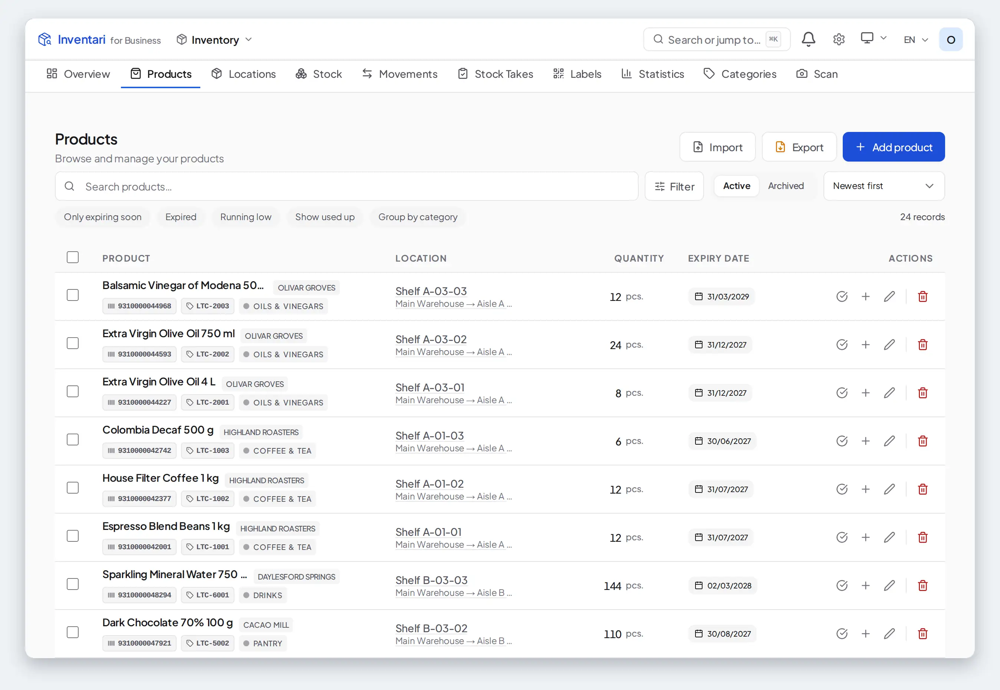

**Products** — what is in stock, where and until when.

## Purchase orders

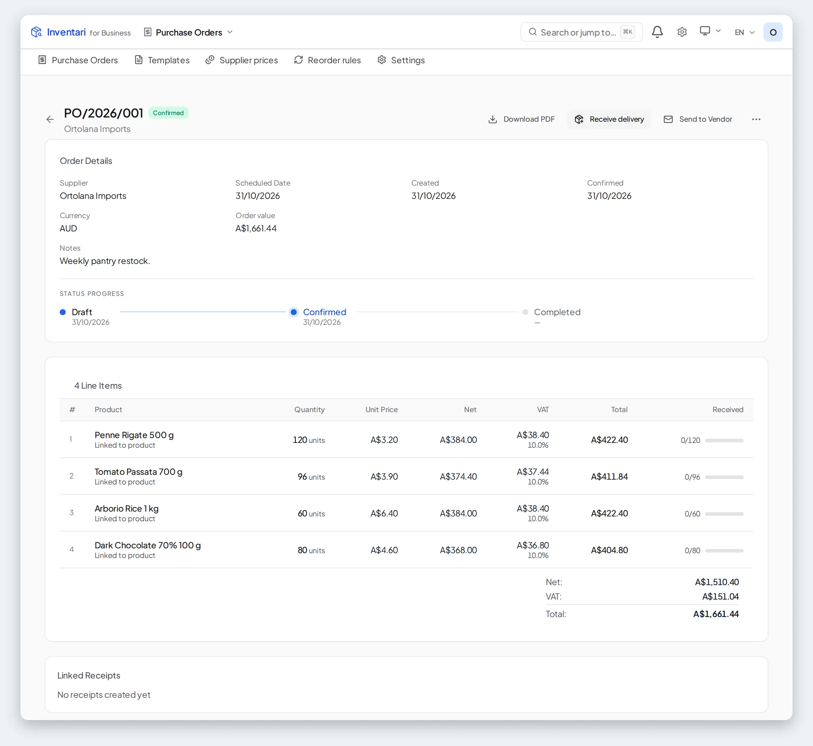

**A purchase order** — the order line by line, and how much of it has
arrived.

## Equipment

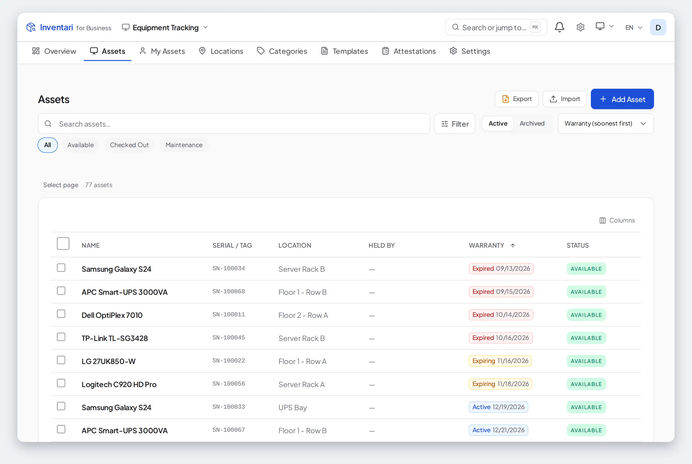

**Assets** — serials, locations, warranties and who signed for what.

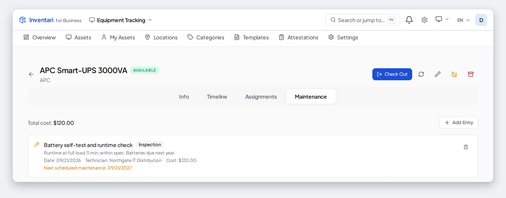

**Maintenance** — every inspection and repair, its cost and the date of the next one.

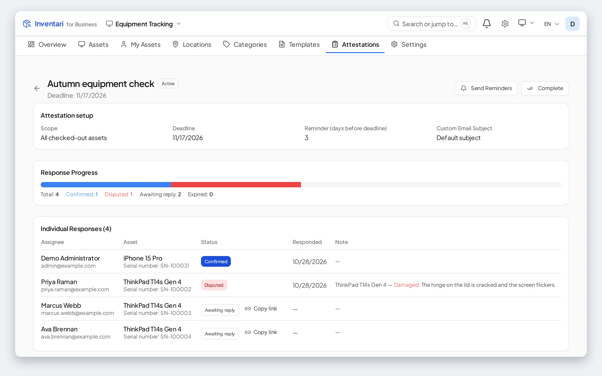

**Attestation** — ask everyone who holds equipment to confirm they still have
it, and hear back about what is broken.

## Kitchen

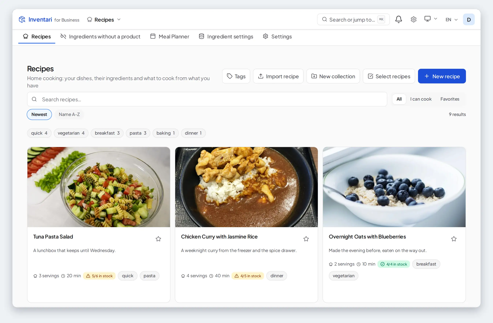

**Recipes** — "I can cook" means every ingredient is on the shelf; the near
misses say what they are short of.

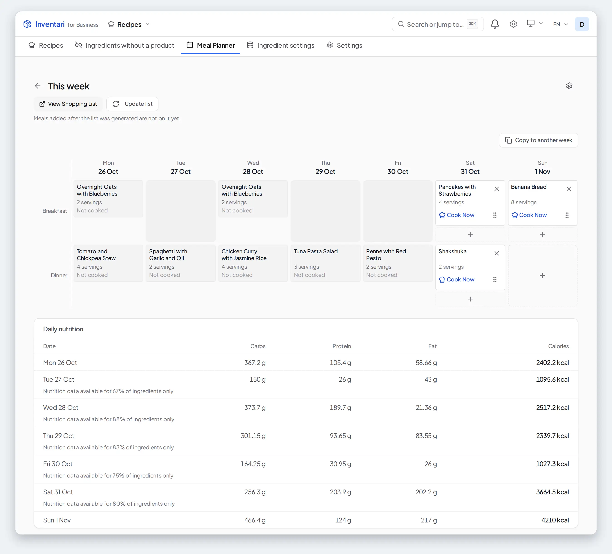

**Meal planner** — a week of meals cooked from stock, with what each day adds
up to.

## Production

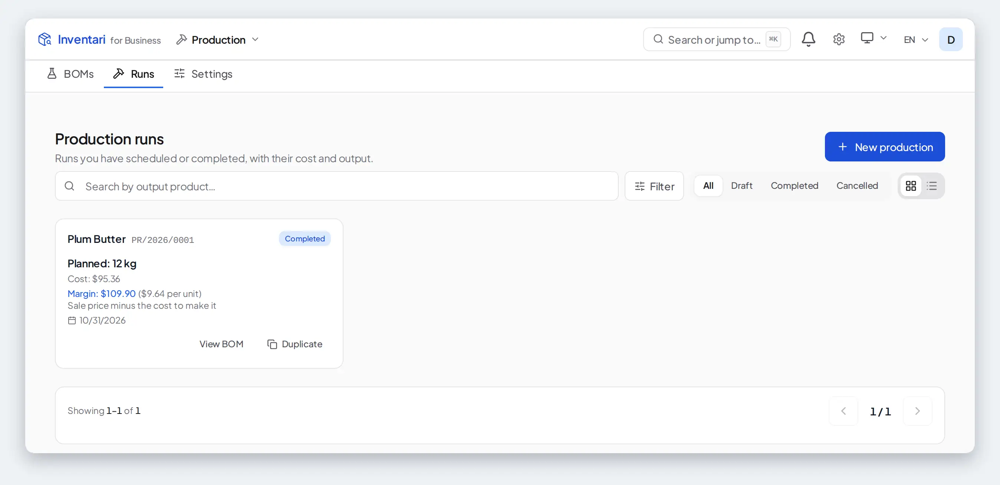

**Production runs** — what was made, what it cost and what it was worth.

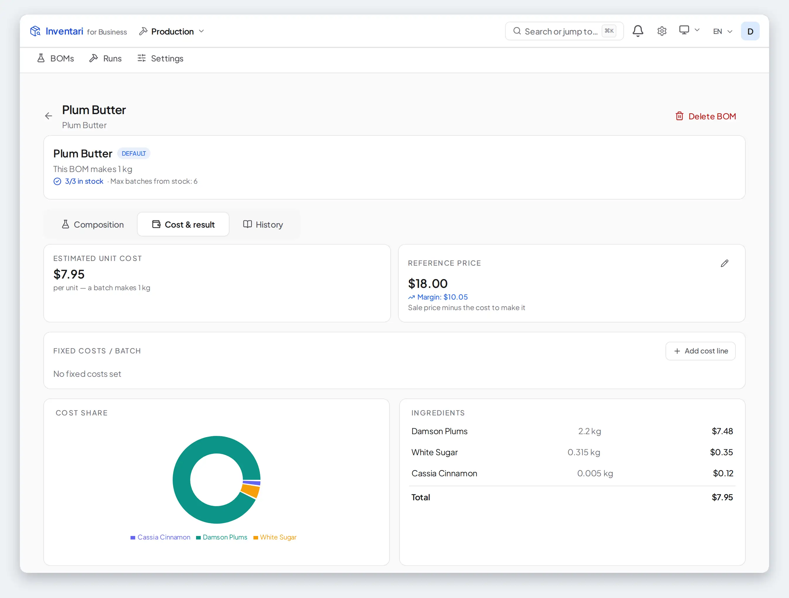

**BOM cost** — the cost of a unit from the prices of its ingredients,
against a reference price.

The README shows the finished run in dark mode: what went in at its FIFO
cost, what came out, and every shelf it touched.

## Stock takes

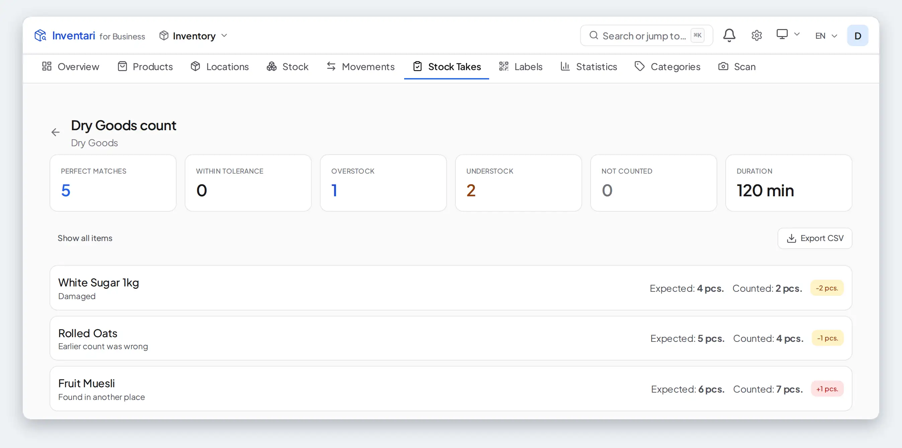

**Stock take report** — the shelf against the system, and why each difference
happened.

## On a phone

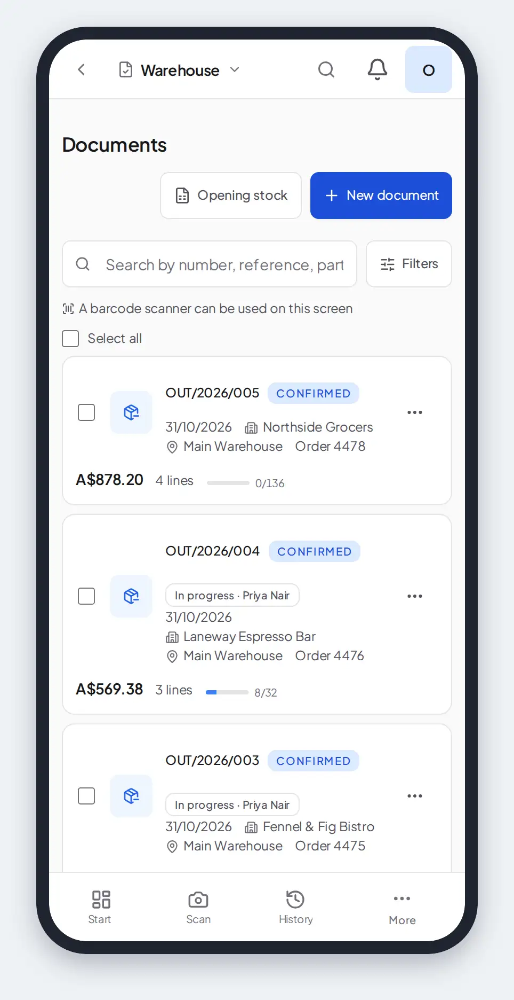

**Warehouse** — the same list, laid out for a phone.
