# Inventari — User Guide

This guide walks through Inventari the way you meet it: first the account and
the workspace, then the locations you keep things in and the products on them,
and then one chapter per area — the kitchen, equipment, the warehouse,
purchasing and production. Names of screens, tabs and buttons are written the
way the English interface shows them, in **bold**.

The pictures are screens of the demo organization, rebuilt from its seed. The
picking and packing screens in 10.10 add one delivery to it, written and picked
through the application ([gallery](GALLERY.md#warehouse) says how).
The [gallery](GALLERY.md) shows more of them, module by module.

What you see depends on two things:

- **Which modules are switched on** for your organization. A module that is
  off has no tile, no tab and no button anywhere. Administrators switch them in
  **Settings → Modules** (chapter 14).
- **Your role.** Administrators see everything, including the settings. Other
  roles see the screens their permissions allow, and read-only screens say so.

## Contents

1. [Getting started](#1-getting-started)
2. [Locations](#2-locations)
3. [Products](#3-products)
4. [Scanning](#4-scanning)
5. [Labels](#5-labels)
6. [Stock levels, batches and movements](#6-stock-levels-batches-and-movements)
7. [Stock takes](#7-stock-takes)
8. [The kitchen: recipes, meal plans and shopping lists](#8-the-kitchen-recipes-meal-plans-and-shopping-lists)
9. [Equipment](#9-equipment)
10. [Warehouse](#10-warehouse)
11. [Purchase orders](#11-purchase-orders)
12. [Production](#12-production)
13. [Partners and approvals](#13-partners-and-approvals)
14. [Settings and administration](#14-settings-and-administration)
15. [Statistics](#15-statistics)
16. [Key ideas](#16-key-ideas)

---

## 1. Getting started

### 1.1 Your account

- **The first account on a new installation becomes its administrator.** Open
  the address, choose **Create new account**, and fill in **Email address**,
  a **Full name (optional)** and a password of at least 8 characters with a
  lowercase letter, an uppercase letter and a digit. Do this before you tell
  anyone the address — see [QUICK_DEPLOY.md](../QUICK_DEPLOY.md).
- **A development install already has one.** `make dev-up` creates an
  administrator and prints its email and password when it finishes. On a
  server, `manage.py user create-admin` does the same from the command line.
- **Everyone else is invited.** An administrator sends an invitation from
  **Settings → General → Invite User** (chapter 14). The invited person opens
  the link, creates an account and lands in your organization with the role the
  invitation named. An invitation is valid for 7 days and only for the email
  address it was sent to.

The sign-in page also offers **Request access**. A request is decided by the
instance's superuser — the first account created on the instance, unless the
operator named another — who alone is notified about it and sees it under
**Settings → General → People**. An
approved request creates an account with an organization **of its own**, not
a place in yours — to bring someone into your organization, invite them.

### 1.2 Choosing how you work

A new organization starts with a short setup, **Choose your workspace mode**. Only an
administrator can complete it; anyone else sees *Only an administrator can set
this up*.

| Choice | What it switches on |
|---|---|
| **Food & Home** | Recipes, Shopping Lists, Stock Takes, Statistics, nutrition data and photo recognition. Starts with the locations *Fridge*, *Shelf A* and *Freezer*. |
| **Equipment & Warehouse** | Equipment Tracking, Warehouse, Purchase Orders, Partners, Approvals, Stock Takes and Statistics. Starts with *Main Warehouse*, *Server Room*, *IT Storage* and *Quarantine*. |
| **Custom** | Only the always-on core (products, locations and categories) and Stock Takes. Starts with one location, *Main Storage*. |
| **Just one module** | One module is the whole app and everything else steps back (focus mode — see [Focus mode](FOCUS_MODE.md)). A second step, **Which module?**, lists the modules that can stand on their own: Equipment Tracking, Production, Recipes, Shopping Lists and Warehouse. |

The first three land on the launcher (section 1.3) — a mode colours the app, it
does not decide where it opens. **Just one module** lands in the module you
picked.

Under the choices, name the organization and pick its **Currency** and **Country**; the country
is prefilled from the browser's language where it suggests one, and sets the
standard tax rate and partner rules of the organization's documents. **Equipment & Warehouse**
and **Custom** then show a second step, **What should it start with?**, where
you tick modules on or off — for example Production, Warehouse, photo
recognition, API keys or webhooks. **Get started** applies everything.

Nothing here is final. Modules can be switched at any time (**Settings →
Modules**), and the whole choice can be changed later in **Settings →
My modules** (chapter 14).

### 1.3 Finding your way around

- **The launcher** (click the Inventari logo) shows one tile per module. On a
  desktop you can drag tiles to reorder them. A tile carries a small badge when
  its module has something to show — *low stock* on Inventory, *warranty
  alerts* on Equipment Tracking, *to do today* on Warehouse. Beside the
  tiles, when there is something to show, are **To do** — stock takes in
  progress and, for people who may decide them, approvals waiting — and the
  places you **Recently visited**.
- **The module switcher**, next to the logo inside a module, jumps between
  modules without going back to the launcher.
- **Search** — the **Search or jump to…** box, or ⌘K / Ctrl+K — finds products
  by name, brand, barcode, label code or serial number, and recipes and
  equipment when those modules are on. It also lists every module under
  **Switch to**, and has **Quick actions**: **Add new product** and
  **Scan barcode** — and, with the Warehouse module on, **Scan document**.
- **The bell** holds your notifications.
- **The screen icon** switches between **Light**, **Dark** and **Follow system**.
  The choice is kept by this browser.
- **The language selector** (EN, PL, DE, FR, ES, and PT, a community translation that may still show English in places) is saved to your account.
- **Your avatar** opens **My profile**, **About**, the **User guide** and
  **Log out**.

On a phone, the top bar keeps search, the bell and the avatar; settings, the
theme and the language move into the avatar menu (**Settings**,
**Appearance**, **Language**). Inside Inventory, a bar at the bottom offers
**Overview**, **Scan** and **More** — the last one holds the rest of the tabs
and links to the other modules.

---

## 2. Locations

Everything in Inventari sits somewhere. Locations form a tree of any depth —
a building, a room, a cabinet, a shelf — and a product can sit at any level,
not only on the lowest one.

### Where locations are managed

**Inventory → Locations** lists them: the locations that no module owns. A
location that belongs to a module, such as the equipment rooms, stays out of
that list until **Show module data in general lists** is switched on under
**Settings → General** (chapter 14). **Equipment → Locations** offers a
narrower view over the same tree: the locations that hold equipment
(similarly **Equipment → Categories** shows the equipment ones).

### Adding and arranging

- **Add location** starts a short wizard: *Where do you keep your things?*,
  *What is inside this location?*, and optionally *How to track products
  here?* — which fields the products in this location ask for.
- The **Locations** screen shows the whole tree beside the selected location.
  Drag a location onto another, or use **Move to…** (with **Top level** in it)
  in a row's menu, add a child with **Add location inside**, or delete one
  from its **Settings** tab (its children move up a level).
- Click a location in the tree to open it in the pane on the right. It shows
  what is in it under the tabs **Contents**, **Products**, **Settings** and
  **Moves**, and offers **Add location inside**, **Add product here** (with
  the location already filled in), **Move to…** and — once the location has a
  code — **Print Preview**, which downloads the location's QR label.
- The **Settings** tab lets you rename the location, describe *How to get
  there*, choose its location type and tracked fields, add custom fields and
  put it under another parent (**Lies in**). Its *Walk order* number — the
  order picking visits locations in (10.3) — is set with the warehouse's
  **Location settings**, below.

### Location codes

Every location has a code, printed on its label. Scanning it tells Inventari
where you are standing, so products you add next go there by default
(chapter 4), and a picking or receiving session knows which shelf you are at
(10.3). A code is the sticker, not the name: renaming a location never changes
its code.

How codes are made depends on how you work (1.2), and is set per warehouse —
a location at the top of the tree:

- **At home** (*Food & Home*) codes are drawn at random, such as `LOC-7KQ2`.
  For a pantry the code is only a code, and it is printed as a QR label.
- **In a business** (*Equipment & Warehouse*, *Custom*) codes follow the
  tree, so a person reads the place off the sticker without scanning:
  `A-02-01` is zone A, rack 2, level 1. A new location under a numbered one
  takes the next code among its neighbours — the second rack in zone A is
  `A-02`, the first level on it `A-02-01`. A number is never one an old
  sticker still carries, and a location you type a code for keeps it.

The **code template** says how. Each level below the warehouse has a
placeholder, with a separator between them: `{zone}` gives letters (A, B, …,
Z, AA), `{rack:02}` numbers padded to two digits (01, 02, …). The business
default is `{zone}-{rack:02}-{level:02}`; a template of your own might be
`W2/{aisle:03}.{bay}`. A prefix alone, such as `LOC`, draws random codes. A
level deeper than the template draws a random code too.

With the **Warehouse** module on, all of this is done in **Warehouse →
Codes and labels** (under **More** on a phone), so a warehouse in
focus mode never leaves the module:

- The **Location codes** card names the warehouse's template. **Code
  template** changes it — or, left empty, goes back to the default of your
  way of working. Changing the template rewrites no code.
- **Renumber by template** gives every location of the warehouse that does not
  read like the template yet the code its place in the tree gives it, family
  by family in walk order; a code that already reads right stays as it is.
  **Give template codes** in the selection bar does the same for the ticked
  locations and everything under them, numbering what is left after the
  highest code — the way to number a rack set up before its zone had a code.
- **Old stickers keep scanning.** When numbering changes a code, the old one
  stays behind as a label in the pool pointing at the same location, so the
  sticker on the shelf still names it in receiving, picking and stock takes
  until you replace it. The card lists those locations with their old and new
  codes: **Print new labels**, stick them on, then **Mark as replaced**.
- **Print labels for this list**, beside the warehouse picker, prints the
  labels of the locations the list shows; **Print labels** in the selection
  bar prints those of the ticked ones. A label shows the code large,
  in Code 128 that a USB 1D scanner reads, the location's name under it and,
  if you tick it, a QR beside the bars for a phone camera. **Download** gives
  the image; **Send to printer** goes to the print agent (chapter 5).

**From home to business.** Switching your way of working from *Food & Home*
to a business mode (**Settings → My modules → Modules you see**, chapter 14) keeps every code,
and every sticker keeps scanning.
The switch says that renumbering is available; nothing is renumbered until
you choose **Renumber by template**.

A QR sticker printed earlier carries a web address. A 2D hardware scanner
types that whole address into the field, and every scan field in the
warehouse reads the code back out of it, so old QR stickers name their shelf
there too.

### Archiving and deleting

- **Archive** takes a location out of use. If it still holds products, you
  choose where they go first. An archived location comes back with **Restore**
  on the **Archived locations** page, linked under the tree.
- **Delete** works only on a location that holds nothing and that no recorded
  movement has ever passed through. Otherwise Inventari tells you to archive it.

### Capacity

With the **Warehouse** module on, a location's **Settings** tab also shows its
**Location settings** — the walk order, whether different products may stand
there, the limit per product and how full it is — with **Set up location** to
change them. Receipts use those limits when they decide which shelf goods go
to (chapter 10).

On a shelf with several products, each product's limit is its own room, and
the shelf is full when the shares add up to 100%: 20 of 40 bags of rice and
25 of 50 kg of plums fill it. A product without a limit adds no share; the
occupancy says that part of the shelf is not counted.

### Locations you do not create

Inventari keeps three locations of its own — *Consumed (Virtual)*, *Inventory
Loss (Virtual)* and *Production (Virtual)*, named in the interface language.
They stay out of the location lists and pickers. When a product is used up,
its record moves to one of them, which is how its history survives at zero
(chapter 3).

---

## 3. Products

### 3.1 Adding a product

**Inventory → Products → Add product** (or **Add new product** in search).
Only **Product name** and **Location** are required; everything else is
optional.

| Field | What it is |
|---|---|
| **Product name** and the photo box | The name, and a photo taken or chosen from the device |
| **Location** | Where it stands. **Manage locations** opens the list in a new tab |
| **Brand**, **Category** | A category can be created from the picker |
| **Shelf Location** | Free text, such as "Shelf A, rack 2" |
| **Quantity** and **Unit** | How much, in pieces, kilograms, litres, packs… |
| **Weight / volume per piece** | For products counted in pieces; the total is worked out for you |
| **Expiry date** | With shortcuts for 6 months, 1 year and 3 years |
| **Freeze date** | For your information; no rule or alert uses it |
| **Purchase price per unit** | The price of one unit, not of the whole quantity |
| **Serial Number**, **Description / Notes** | |
| **SKU** | The product's own stock-keeping number, letters, digits, dashes, underscores and slashes, up to 50 characters, kept in upper case. Leave it empty and the organization's numbering gives one, where it is switched on. It belongs to the product: changing it on **Edit** changes it for every record of it, and the change is in the audit log |
| **Product code** | The barcode. Shown when a category or location tracks it, and filled in for you when you add a product by scanning. A product that came without one gets one from **Generate code** (chapter 5) |

Some fields appear only where they make sense: a location can limit the
product form to its own tracked fields, and a category can add fields of its
own (**Additional info**) or hide the food ones. A field a category marks
required is required everywhere: the form stops at it, and an API call or an
import row without it is refused with the field's name.

Good to know:

- **The last location and category are remembered** for the next product. A
  banner says so, with **Clear** to start fresh.
- **There is no duplicate warning.** Saving again adds another record. If the
  barcode, or the name and brand, match a product you already have, the new
  record is filed under that same product, so stock levels and history add up.
  Import works the same way: a row whose barcode, or name and brand, matches
  an existing product becomes another record of it. A row is refused when its
  serial number is already on a record you have, or when its barcode is worn
  by a live record of a different product. To update products instead of
  adding records, import with the Label Code column mapped and a match mode
  on; a row without a code always adds.

**From a photograph.** With photo recognition on, the page has a **Vision AI**
tab: **Take Product Photo**, then **Analyze label**. It reads the name, brand, expiry
date, weight, nutrition and ingredients from the label and fills them in for
you to check; a category is filled only when it matches one you already have.
It needs an AI connection for *Read a product from a photo*
(**Settings → AI connections**, chapter 14).

**From a barcode.** Scan it (chapter 4). When the nutrition module is on and
your administrator has installed the Open Food Facts product database, an
unknown barcode fills in the name, brand, photo and nutrition from it. That nutrition comes from a community
database: check it against the label, and see the note on allergens and nutrition in chapter 8.

### 3.2 The product list

- **Active** and **Archived** tabs, a search box, and **Filter** by location and
  category.
- Chips: **Only expiring soon** (within 7 days, today included) and **Expired**
  (when your locations track expiry), **Running low**, **Show used up** (records
  at zero), **Group by category**, and **BOM** when Production is on.
- The number above the list counts records, one per batch or shelf a product
  stands on, not products; the category cards count products.
- Sorting by date added, name, quantity or expiry.
- **Import** reads XLSX, CSV or a Grocy export, and can create missing locations
  and categories as it goes. A row filed under a product you already have takes
  that product's name, and one whose unit cannot be converted into the
  product's is refused with both units named. **Export** downloads what the
  list currently shows as XLSX, with the SKU, description, stock alert, the
  values of the category's custom fields and each location as its full path;
  its second sheet says which columns an import reads back.
- Each row has **Remove 1 unit**, **Add 1 unit**, **Edit**, **Delete** and a bell,
  **Set stock alert**, for the minimum below which the product counts as
  running low. Clicking a row opens its quick actions.
- Tick several rows to **Bulk Edit** their location, category, price, brand or
  expiry date, to delete them, or to **Print labels** with their barcodes
  (chapter 5).

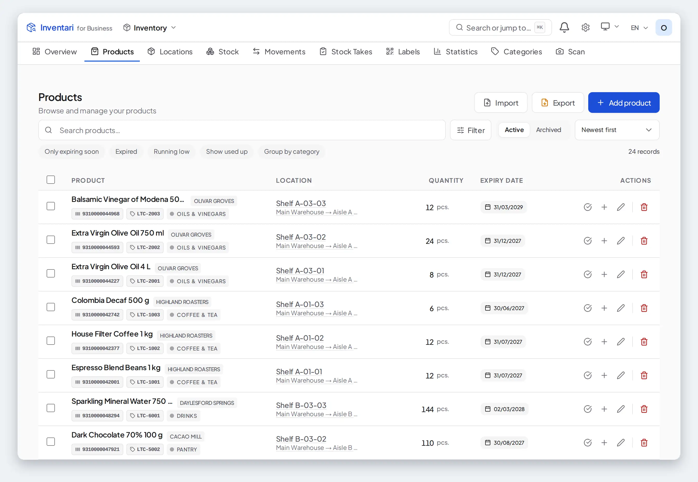

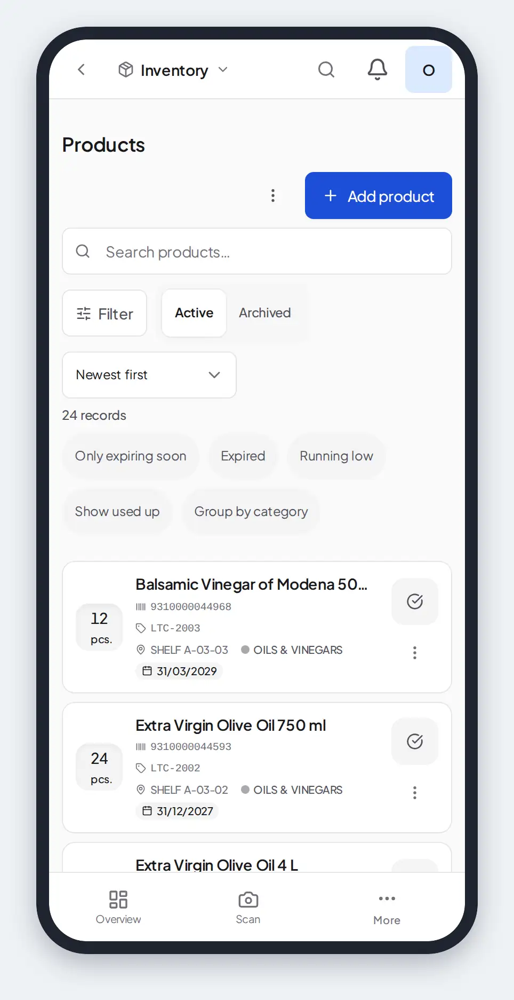

### 3.3 A product's page

Tabs: **Overview**, **Change history**, and **Movements** when movements are
recorded (chapter 6). **Where it lies → In every location** lists every location
the product stands.

The actions at the bottom:

- **Add 1 unit** adds one.
- **Remove 1 unit** takes one away as used, whatever the unit measures. To
  take a different amount, use **Remove 1 unit** on the list row, which opens
  a dialog where you type it.
- **Move** moves the whole record to another location.
- **Print label** prints the product's name and its code as a barcode
  (chapter 5); it shows once the product has a code or a SKU.
- **Delete** asks for a reason and archives the record; it can be restored from
  **Archived**. Deleting needs the permission to delete products, which the
  built-in **Administrator** role has.

### 3.4 Taking things out

The **Remove from stock** dialog (the row's **Remove 1 unit**) asks how much
and why:

- **Used** and **Other** count as consumed.
- **Disposed**, **Damaged** and **Expired** are booked as disposals: the reports count them as waste, not as use.

When a record reaches zero it leaves the list — it moves to one of the locations
Inventari keeps for itself (chapter 2). **Show used up** brings such records
back into view; on their page, **Move** returns one to a shelf and **Add**
restores a quantity.

### 3.5 Expiry and low stock

- A product is **expired** from the day after its expiry date, and **expiring
  soon** from 7 days before it. Days are counted in the organization's time
  zone.
- It is **running low** when its total across all real locations is at or
  below the minimum set with **Set stock alert**.
- **Inventory → Overview** gathers all three in one **needs attention** card,
  which counts them in its heading, each product once, under its most urgent
  reason. When Shopping Lists is on and something is low, **Replenish All**
  proposes what to add to your shopping list.

Expiry and low stock are shown on screen and in **Statistics**; they do not
raise notifications in the bell.

### 3.6 Units

Units come in groups — weight, volume, length and counts. Quantities convert
within a group (500 g and 0.5 kg are the same thing) but not across groups:
a pack is not converted to pieces, nor a cup to grams. Counted units (pieces,
packs, bottles…) take whole numbers only, so "0.5 pcs" is refused. Changing a
product to a unit from another group clears its quantity.

---

## 4. Scanning

**Inventory → Scan** on a phone (or **Scan barcode** in search) opens the
camera; on a desktop, **Start Camera**, or type the code under **Or type code
manually**. It reads QR codes and EAN/UPC barcodes.

| You scan | What happens |
|---|---|
| A location code (`A-01-02`, or `LOC-…` at home) | A sheet with the location's path and everything stored there, shelves below it included, with quantities, batch and use-by date. **Use as scan context** makes the products you add next go to that location (**Clear the location** forgets it); **Open location**, **Start a stock take** (counts this location and the ones below it) and **Move** continue from there. The same sheet opens from the Warehouse scan page. |
| A free label (`STM-…`) | A new product form opens, bound to that label — or **Attach to an existing product** to bind it to a product you already have. |
| A label already on a product | The product's quick actions. |
| A label of a deleted product | Its archive record, with **Reuse label**. |
| A document number | The document (with Warehouse on). |
| A barcode you have in stock | *In Stock*: every location with **+** and **−**, **Remove 1 (first to expire)**, **Add to location**, **Add to shopping list** and **View all details**. |
| A barcode you have had before, now at zero | A new product form, filled in from it. |
| An unknown barcode | A new product form, filled in from Open Food Facts when that database is installed. |

On the *In Stock* sheet, **−** takes one unit from that location, and
**Remove 1 (first to expire)** takes one unit from the record that expires first.

**A USB or Bluetooth barcode scanner** is supported without any setup, as long
as it acts as a keyboard — most do, and so do the scanning keyboards on
Android phones. The phone's camera has been tried on these screens with a real
phone; a hardware scanner has not yet been tried with real hardware. These screens listen for it and say *A barcode scanner can be used on this screen*:
**Inventory → Scan**, **Warehouse → Scan** (the phone's middle tab; on a
desktop it opens from **Start** — **Scan a code** — and from inside an
action), the **Scan picking** and **Scan
receiving** sheets of a document, and the **Documents** list, where the code
becomes the search. The code is taken wherever the cursor is, except inside
another field you are typing in. A scanner has to end each code with Enter or
Tab, which is how they come set up; prefixes and other endings cannot be set
yet.

---

## 5. Labels

**Inventory → Labels** keeps a pool of printed QR codes that you stick on
things before or after they go into Inventari.

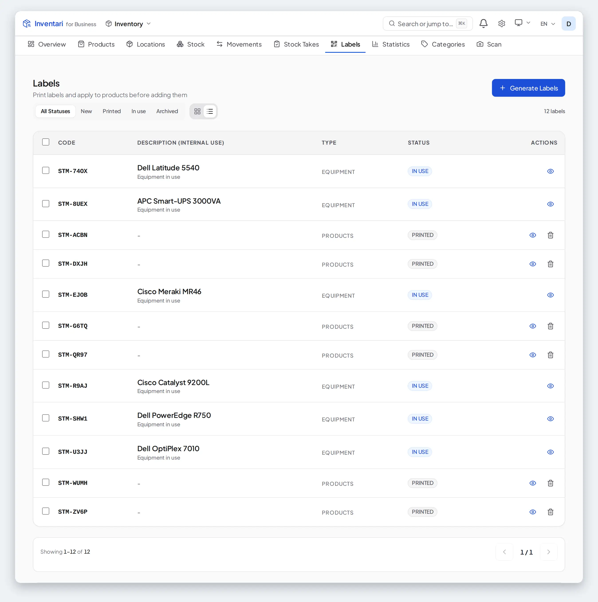

- **Generate Labels**: how many (up to 500), a prefix of up to five letters or
  digits (`STM` unless you change it, giving codes such as `STM-4F2A`), and an
  internal description.
- Statuses: **New** — never printed or used; **Printed**; **In use** — assigned to
  a product; **Archived** — its product was deleted.
- **Printing.** Select labels and press **Print Preview**. Choose a size (a
  preset or your own in millimetres), copies per label and what the label
  shows, then **Download N labels**. The download is an image you print from
  your computer; downloading marks the
  labels **Printed**.
- **Printing straight to a printer** is done by the separate
  [print agent](../print-agent/README.md), which runs next to the printer and
  drives a Brother P710BT, a CUPS queue or any command.
- **Putting a label on a product.** Scan a free label: the new product form
  opens and the saved product is bound to that label. For a product you have
  already entered, press **Attach to an existing product** on that form, search
  for the product and pick it; or open the product's page and press **Attach a
  label**, then choose a free label from the pool (or make a new one). A product
  that already has a label keeps it and does not offer either door.

Shelf labels with a Code 128 barcode, for a business warehouse, are printed
from the Warehouse module (chapter 2, *Location codes*).

On the public demo, **Label sheet** in the banner above every screen opens
one sheet with that copy's shelf and product codes to print and scan with a
phone — receive goods, put them away and pick them again — before you set up
a warehouse of your own.

### Product labels

A pool label carries a QR that points at a record. A **product label** carries
the product's own code as a barcode — the code a receiving or picking scan
finds the product by — with the product's name above it and, when the record
has them, its batch and expiry date below.

- **A product without a code.** Open its form (**Edit** on the product's page,
  or **Add product**) and press **Generate code** beside the empty **Product
  code** field. It fills in an internal EAN-13 starting with `20`, the GS1
  range a company may use for its own goods; no two products in the
  organization get the same one, and a code a product already has is skipped.
  It is the organization's own internal code, which cannot be mistaken for a
  manufacturer's, and it is valid only inside the organization: goods sold on
  through other businesses' tills need a GTIN from GS1.
  **Save changes** keeps it. A product that already has a code does not offer
  the button: changing the code would orphan the labels already on the shelf.
- **One product.** On a product's page, **Print label** (shown once the
  product has a code or a SKU). Choose a size (*Standard* 50×24 or *Large*
  62×29, or your own in millimetres), copies, and whether to print the batch
  and expiry date. The preview is the file; **Download** gives the image to
  print, and **Send to printer** goes to the print agent when one is
  connected.
- **Several products.** Tick them in **Inventory → Products** and press
  **Print labels** in the selection bar. Products without a code are left out,
  and the window says how many.
- **What the barcode is.** A valid 13-digit EAN is printed as EAN-13, which
  every scanner reads; any other code, a SKU included, as Code 128. Scanning
  the printed label in a picking or receiving session finds the product the
  same way scanning the maker's barcode does.
- **A long code needs a wide label.** The bars are printed whole or not at
  all: a code too long for the chosen width (a long alphanumeric code on a
  50 mm label, say) is refused with the width it needs, rather than printed
  with its end cut off where no scanner can read it. A label too short
  for its name, bars and text is refused the same way: choose a taller one.

---

## 6. Stock levels, batches and movements

These screens exist only when a module that moves stock is on — **Warehouse**,
**Purchase Orders**, **Production** or **Stock Takes**. Without one of them,
the product list is the whole record of your stock, and the **Stock** and
**Movements** tabs are not shown.

### Stock levels

**Inventory → Stock** shows, for each location and product: **On hand**,
**Reserved** (held for confirmed outgoing documents, chapter 10) and
**Available** — what is left for new orders. Filter by location, include
locations at zero, or search.

### Batches

**Batches** on the Stock page lists every batch received under a batch or
serial number. A batch is **Active**, **Quarantined**, **Held**, **Expired** or
**Recalled**; changing that needs a reason. Only active batches within their
expiry date are ever picked for an outgoing document. A batch's page shows
where it is, everything that happened to it, and every decision about its
state.

Which batch leaves first is set on the product, under **Which stock leaves
first** in its **Edit product** form: **FIFO** sends out what came in first,
**FEFO** what expires first, whenever it came in. A product with neither set
goes FIFO; its page shows the order under **Issue order**. A category's
**Issue order for new products** (**Inventory → Categories**, in the category's
form) is the order a product created in that category starts with; changing
it later leaves existing products as they are.

### Stock on a date

**Stock on a date** answers "what did we have on the 31st?": pick **As of** and
optionally a location, then **Export** or **Print**. Values appear where the
cost history reaches back that far.

### Movements

**Inventory → Movements** is the journal of everything that came in
(**Received**), went out (**Issued**) or moved between your own locations
(**Moved**). Each line names the product, quantity, from and to, batch, who did
it, and its source — a document, a hand entry (**By hand**), a stock take, a production
run — with a link back to it. Filter by direction, location, dates or product,
and **Export** the result.

---

## 7. Stock takes

**Inventory → Stock Takes → New stock take** counts one location together with
everything under it. Options:

- **Blind mode** hides the expected quantities from the person counting.
- **Tolerance** — the difference, as a percentage of the expected quantity,
  that is accepted without questions.
- **Require full count** (on by default) — the count cannot be completed until
  every line is counted.

Only one count can run on a part of the tree at a time.

**Counting.** Scan each piece: a code read by a USB or Bluetooth scanner, read
by the camera (**Scan with camera**) or typed into the search box and confirmed
with Enter counts one more of that item and saves it at once. When the code
fits several items of the count — the same product on two shelves or in two
batches — a short list asks which one you are holding. A code that matches
nothing stays in the search box, whose results list the items of this count
first and the rest of the organization below. You can also set the counted
quantity with **+** and **−** and save each card, and add a note when needed.
**Add new item** and **Add as surplus** take products found on the shelf that
the system did not expect; scanning such a product adds it as a surplus too.
When a count differs, **Why does this differ?** records the reason — damaged,
past its date, lost or taken, found in another place, counted in the wrong
unit, and so on. A reason is required when a difference exceeds the tolerance.

**Counting by location.** A count over a rack or a whole warehouse is easiest
done shelf by shelf. Scan the label of a shelf — its own code or a location
label printed for it — and the screen says which shelf you are counting and
lists only what was expected there. Everything you scan next is counted on that
shelf: a product with a line on the shelf is counted on it without asking which
line you meant, and goods the count expected on another shelf are recorded as
found on this one. Completing the count then shows them as a surplus on the
shelf where you found them and, once the other shelf is counted, a shortage
where they were expected. A unit with its own serial number, or goods with no
product card, is counted on the shelf you found it on as well: completing the
count moves it there, and the report shows it missing on the shelf it was
expected on and found on yours (*found in another place* is the reason to
pick when one is asked for).
Scanning the next shelf's label moves you on;
**Whole location** goes back to the full list. A label of a location outside
the count is refused, naming the location being counted, and the screen goes
back to the whole location. Without a shelf scan the screen counts as
described above.

**Closing a location.** When you are done with a shelf, press **Close
location** on the bar that names it. Whatever was expected there and you did
not count is counted as 0: the question before it says how many lines that is
(never what they held, so a blind count stays blind), and the report shows
them as shortages. A shelf with no lines, or with every line at 0, is
confirmed as counted and empty — the bar then says who confirmed it, and the
report lists every closed location, the empty ones marked as such, with who
closed it and when. A number still waiting in its box has to be saved first.
You can go on counting a closed shelf and close it again. Lines on shelves
nobody closed are left as before: they stay uncounted, so a count that
requires every line refuses to complete over them.

**Completing.** **Complete stock take** sets each counted line to the number
you counted, records the reason in its history, and writes every difference
the count found as one **Adjustment** document in the register (10.1) when the
Warehouse module is on; lines you did not count are left alone. It refuses when:

- the inventory period is closed (chapter 10),
- stock changed while you were counting — those lines go back to be counted
  again,
- a difference over the tolerance has no reason, or has not been accepted by
  someone allowed to approve stock takes (the built-in Manager and
  Administrator roles),
- a count is more than five times what the system holds, until someone allowed to
  approve stock takes accepts it. A line the system holds nothing of is not
  measured against this rule, since five times nothing is no limit; when the
  count has a tolerance, any number counted on such a line is a difference
  over it, and waits for a reason and an approval as above.

**Cancel** throws the count away without touching stock. The **report** shows
perfect matches, differences within tolerance, overstock, understock and lines
not counted, and exports to CSV.

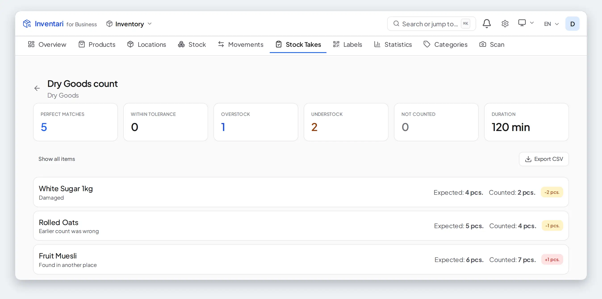

---

## 8. The kitchen: recipes, meal plans and shopping lists

### 8.1 Recipes

**Recipes** lists your recipes with the tabs **All**, **I can cook** and
**Favorites**. *I can cook* splits into **Ready to cook** — everything needed
is on the shelf — and **Nearly there** — at least half of it is.

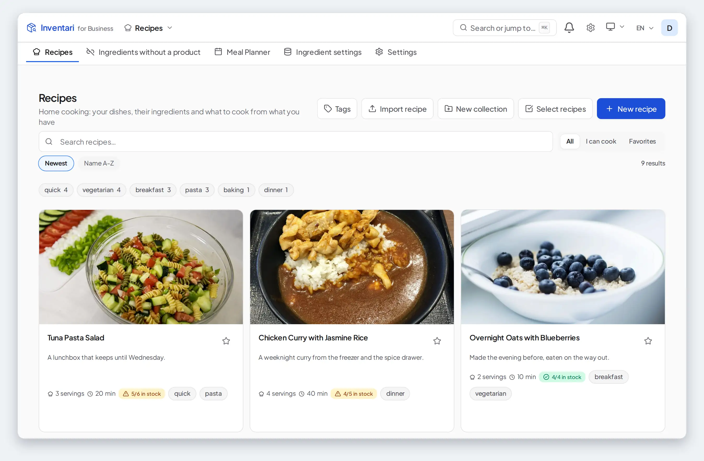

- **New recipe**: name, description, ingredients (quantity, unit, optional,
  calories, allergens), instructions, photo, servings, preparation time, tags.
- **Import recipe**, **Import from URL**, reads a recipe from a web page. It
  needs an AI connection for *Read a recipe from text* (chapter 14), goes
  through an outside reading service, and counts against the organization's
  shared monthly AI request budget — the same one the connection test draws on.
  There is no separate import ceiling, and none at all unless an administrator
  sets one. **Import from JSON** takes Inventari's own recipe format. Both end
  in a review step before **Save recipe**, where a line whose unit the import
  could not read is marked and has to be given a unit before it can be saved.
- **Tags**, **New collection** and **Select recipes** organize them; a recipe
  card can be dragged onto a collection.

### 8.2 A recipe's page

Each ingredient shows whether you have it — **Available**, **Similar**,
**Not enough**, **Missing**, **Unknown**, or **Cannot be compared** (the shelf
counts the ingredient in another measure, so no comparison is made) — with the
shelf it stands on and a warning when it is close to its date. The servings control rescales the view,
nutrition and cost without changing the recipe.

- **Link to product** tells Inventari which product an ingredient is. Stock
  checks, cost and taking from stock work only for linked ingredients (or ones
  whose name matches a product).
- The house icon marks an ingredient as **Always at Home** — something you never
  want on a meal-plan shopping list.
- **Add missing to shopping list** adds the ingredients you lack, in the
  quantity you are short of — what the recipe asks for less what the shelf
  holds — to your newest shopping list (or to a new list named after the
  recipe). Ingredients marked *Always at Home* are left out, and ones already
  on the list are not added again. (A "Similar" shelf match buys the whole
  requirement: a name guess is not a deduction.)
- **Take from stock** walks you through the ingredients; scan a barcode or tap
  one. **Each pick takes the stock off the shelf at once**, suggesting the
  batch that expires first. **Undo** puts one pick back, **Cancel picking**
  puts them all back, and **Finish picking** finishes.
- **Cook step by step** shows the instructions one step at a time, with timers,
  and at the end asks *Take the ingredients off your stock?*.
- **Cook a batch for stock** (with Production on) turns the recipe into a draft
  production run that makes a stocked product (chapter 12).
- **Add to meal plan** puts the recipe on a day of a plan.

Further down: **Nutrition** per serving, **Estimated cost** from what the linked
products cost you, and **Cooking history**.

> **Allergens and nutrition are an aid, not a guarantee.** A recipe's allergens
> are suggested from its ingredient names and may be incomplete — "no allergens
> marked" does not mean "contains none", and the printed recipe says so too.
> Nutrition is an estimate summed from the ingredients, using product labels,
> Open Food Facts (a community database) or generic values. Check both against
> the label of each product used. Whoever enters the data and serves or sells
> the food is responsible for it; Inventari gives no dietary or medical advice.

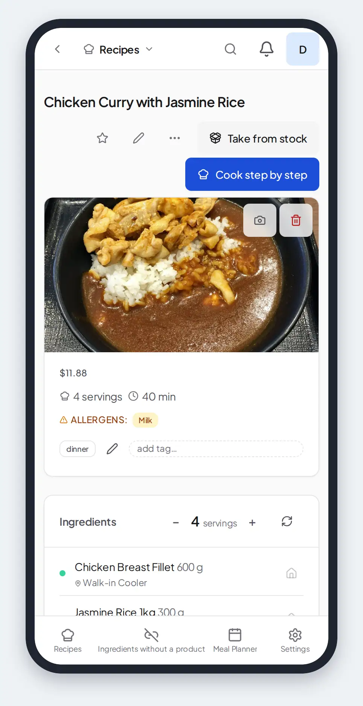

### 8.3 Meal planner

**Recipes → Meal Planner → New Plan**: a name, start and end dates, the meal
slots you use (breakfast, lunch, dinner, snack) and servings per meal.

- Click an empty slot to **Pick a recipe**. The **Suggested** tab favours
  recipes you can cook now, that use up what expires soon, that you have not
  cooked lately and that are quick.
- Drag meals between days. **Cook Now** starts taking the ingredients from stock
  for that meal.
- **Copy to another week** makes a new plan with the same meals, shifted.
- **Generate Shopping List** (with Shopping Lists on) collects what the whole
  plan needs, adds only what you are short of, and leaves out anything marked
  *Always at Home*. The list is made once: meals added to the plan later are
  not added to it.

### 8.4 Ingredient data

**Recipes → Ingredient settings** keeps your own nutrition values per 100 g, unit
conversions per ingredient (a cup of flour in grams, say) and the *Always at
Home* list.

### 8.5 Shopping lists

**Shopping Lists → New list**, then **Add** items or take them **From recipes**.

- Ticking an item marks it **purchased** — it does **not** put anything into
  stock. Bring the shopping in as products (chapter 3) or through a receipt
  (chapter 10).
- **Clear purchased** removes the ticked items.
- **Convert to Purchase Order** (with Purchase Orders on) turns the items that
  are linked to a product into a draft purchase order.

---

## 9. Equipment

**Equipment Tracking** keeps a register of assets — laptops, monitors, phones,
network gear, servers — with who has them, where they are, their warranty and
their book value.

### 9.1 The tabs

- **Overview** — assets that need attention, the fleet by category, recent
  check-outs and the fleet's value.
- **Assets** — the register, with **Active** and **Archived** tabs, filters,
  **Import** (CSV or XLSX) and **Add Asset**. Select several to change their
  **Status** or **Location**, **Assign** them, **Return Selected**, **Retire
  Selected**, **Archive** or **Print labels**.
- **My Assets** — what is checked out to you.
- **Locations** and **Categories** — where equipment stands, and the kinds of
  equipment, each with its own fields.
- **Templates** — handover and return protocol layouts, and **Equipment Models**
  that pre-fill new assets.
- **Attestations** — asking people to confirm they still have what they hold.
- **Settings** (administrators).

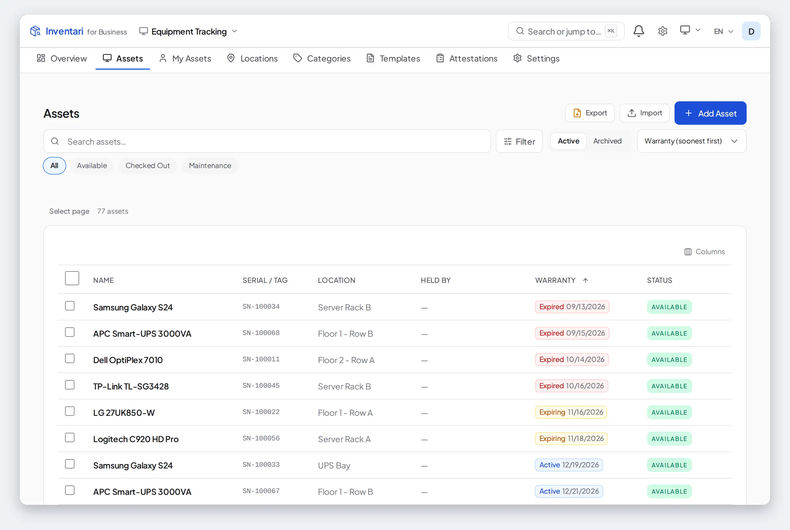

### 9.2 Adding an asset

**Add Asset** takes one asset (**Single**) or many at once (**Batch**, with a
list of serial numbers and optional QR labels for each). **Select model**
pre-fills the fields from an equipment model. **Name** and **Location** are
required, and so is **Category** once the organization has categories for
equipment. Serial number, asset tag, manufacturer, model and useful life come
from the category's fields; laptops also ask for RAM, storage
and operating system. **Purchase & Warranty** takes the price, the purchase date
and the warranty end.

### 9.3 An asset's page

Tabs: **Info** (fields, QR label, **Valuation** — straight-line depreciation
over the useful life — and **Attachments** such as invoices and manuals),
**Timeline**, **Assignments** (with the **Protocol** of each handover) and
**Maintenance**.

| Action | What it does |
|---|---|
| **Check Out** | Hands an available asset to a person — from the partner directory, or by name and email — with an expected return date. |
| **Return** | Takes it back (the button is labelled **Return**). **Return Condition** *Damaged* or *Needs Repair* puts the asset into maintenance. |
| **Request Approval** | Shown when the Approvals module holds checkouts of this kind. An approved request covers one checkout, shown as *Approved for the next checkout*. |
| **Change status** | Between **Available** and **Maintenance**. It is the way out of maintenance. |
| **Edit asset** | Opens the form that changes the asset's fields. |
| **Retire** | The asset stays in the register but can no longer be checked out. Not while it is checked out. |
| **Archive** | Moves it to **Archived**, from where **Restore** brings it back and **Delete Permanently** removes it. |

Give a person's **email** when you check something out to them: it is how the
asset appears under their **My Assets** and how an attestation reaches them.

**Maintenance → Add Entry** records a repair, cleaning, upgrade or inspection
with its date, cost and technician, and the next scheduled maintenance. An
entry does not change the asset's status; use **Change status** when work
starts or finishes. The default date follows the organization's time zone,
as does the service entry created by a damaged return.

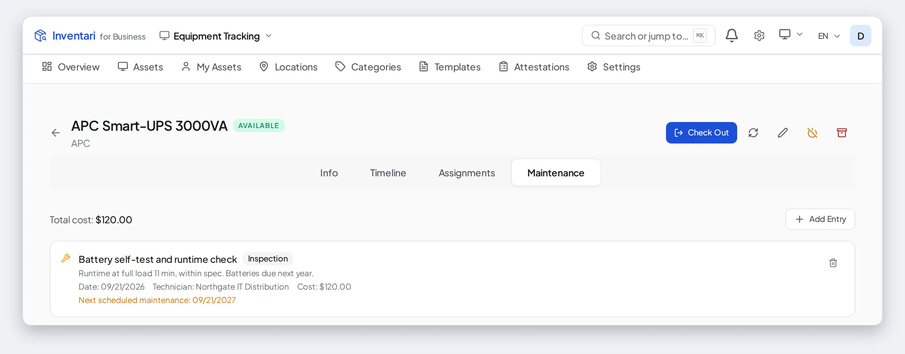

### 9.4 Attestations

**New attestation**: a name, a deadline, a reminder a number of days before it,
and a scope — all assets, or those in chosen locations or categories. **Launch**
sends each person holding assets in scope one email with a link. Without
signing in, they confirm **I have this asset** or **Report Issue** (missing,
damaged, wrong item, other). Someone holding several assets can report one and
confirm the rest in the same visit; the attestation's page names the asset each
report is about. The attestation's page counts confirmed, disputed,
pending and expired answers, lists each response, and has **Send Reminders**
and **Complete**. Assignments without an email are left out.

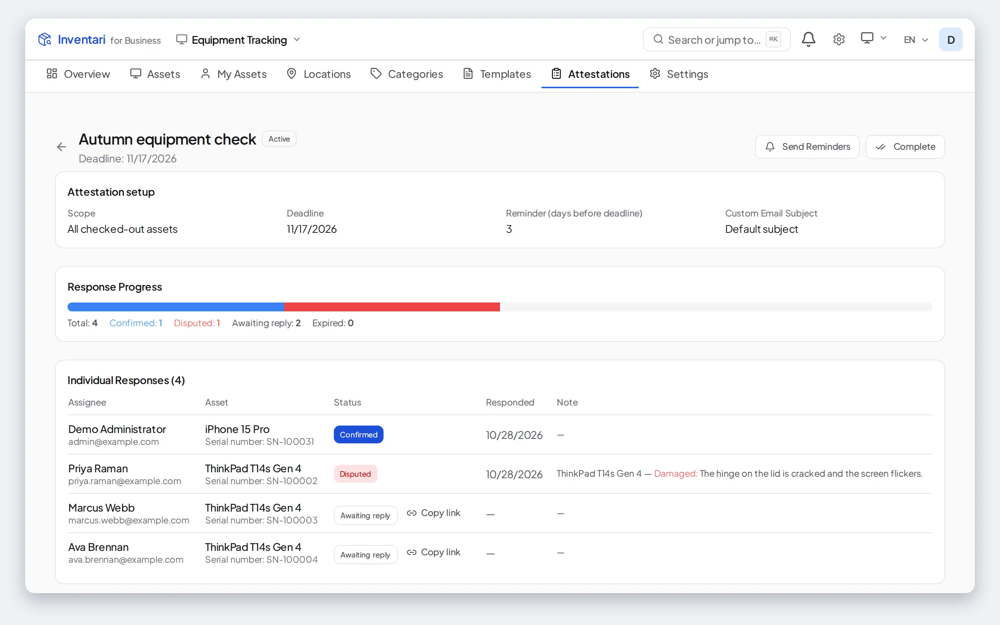

### 9.5 Needs attention

The Overview lists each asset once, under the first reason that applies: its
return is overdue; its warranty ends within the warning window (30 days by
default — the *Equipment & Warehouse* mode starts at 60 — changed in
**Settings**); it is in maintenance and nobody holds it; its warranty
has ended.

---

## 10. Warehouse

The **Warehouse** module is where goods are received, issued, moved and counted; it writes
each of those as a numbered document in the background. Completing a document is what moves the
stock.

The module opens on **Start**, with **Board**, **History**, **Codes and
labels** and **Configuration** beside it; on a phone the bar is **Start**,
**Scan** and **History**, with **Codes and labels** and **Configuration**
under **More**. Start is the floor's
front door: four actions — **Receive goods**, **Issue goods**, **Move** and
**Count**. The first three write and post their numbered document in one
press; **Count** walks a location and, once the count is completed, posts what
differed as one document in the register (7, 10.1). Under them sit the day's
work and activity. Sections 10.1 to 10.9 describe the documents,
the office's own draft flow (the **Documents** list, in History) and the
settings behind both; 10.10 walks one order from the delivery that stocked it
to the parcel that leaves.

The **To do** region on Start is the floor's work queue: what needs doing,
read from the records that ask for it. That is the confirmed receipts and
dispatches planned for today or earlier, the oldest first; deliveries
expected on an order that has no receipt yet; production runs planned for the
day; documents waiting for your approval; backorders; counts that have fallen
due; goods waiting in a receiving area to be put away; and the tasks someone
typed into the **New task** box under the list, with a due date if wanted.
Each task has one button for its next step — **Receive delivery**, **Pick**
and so on — that opens its session in one tap, and a menu to give it to a
person (*Nobody* until one is chosen); **All**, **Mine** and **Overdue**
narrow the list. A task leaves the queue once its source is completed or
cancelled; one typed in leaves when it is ticked off. The Warehouse tile on
the home screen shows how many are waiting. The
document list keeps its type, status and date-range filters in the address of the page, so a
filtered list survives a reload and can be bookmarked or sent to a colleague.

### 10.1 Document types

| Type | Used for | *Poland — warehouse* | *United Kingdom — warehouse* | *Germany — warehouse* | *France — stock documents* | *Spain — stock documents* |
|---|---|---|---|---|---|---|
| **Receipt** | Goods from a supplier | PZ | GRN | WE | BR | AE |
| **Delivery** | Goods to a customer | WZ | DN | WA | BL | AS |
| **Transfer** | Between your own locations | MM | ST | UML | BT | TR |
| **Internal receipt** | Goods made or found in-house | PW | IPR | IE | ERI | EI |
| **Internal issue** | Goods used in-house | RW | IC | IV | SCI | SI |
| **Correction** | Changing the quantities of a completed document | KOR | CORR | KORR | COR | COR |
| **Scrap** | Goods written off | ZL | — | — | — | — |

The last five columns are the short names a preset gives each type. They
appear in document numbers (when the number format uses them) and in the
register; the rest of the interface uses the names in the first column.

An eighth type, **Adjustment**, is not offered under **New document**: a
completed count writes it with the differences it found (chapter 7, while the
Warehouse module is on), and History lists it beside corrections.

### 10.2 Creating a document

**Warehouse → History**, then **New document manually** in the office panel and
the type — or **Documents** in the same panel, where **New document** in the
header does the same.

- **Partner** — the supplier or customer (not on a transfer). With the Partners
  module on, a receipt and a delivery need one; **Create new partner** adds one
  on the spot.
- **From location** and **To location**, as the type needs them.
- **Scheduled date** — it also decides the month the document belongs to.
- **Reference / Related Document** — for example the supplier's delivery note —
  and **Notes**.
- Lines: **Add line** or **Scan**, with the product, quantity and unit, and —
  when value tracking is on — the unit price and VAT. **More fields** adds a
  batch number, serial number and expiry date. For a delivery, issue, transfer
  or scrap each line is picked from stock you actually hold.
- **Taking from a whole warehouse or zone.** The source of a delivery, issue or
  transfer can be a location with shelves under it, not only a single shelf.
  The line search and **Scan** then offer the stock of every shelf below it,
  each row naming its shelf. You do not have to know which shelf to take from:
  **Confirm** chooses for each line, in the order the product's removal
  strategy gives it out (earliest expiry first for FEFO, oldest first for
  FIFO), and when the quantity has to come from several shelves the line is
  split into one line per shelf. Each line then shows **Taken from** and its
  shelf, scan picking walks those shelves, and completion takes the goods from
  them. A line that names a batch is taken from that batch only. On a transfer
  each line moves the record it names, from the shelf that record stands on.
  A line written in a unit other than the product's stock unit is not split:
  if no single shelf holds enough, **Confirm** refuses it and says so. To take
  from one particular shelf, choose that shelf as the source.

Saving creates a **Draft**. A draft carries a temporary identifier
(`DRAFT-…`) of its own; it takes its number when you **Confirm** it.

- **Import lines** fills lines from a CSV or XLSX file or pasted text, with a
  column mapping — on a new document as you write it, or on a draft through
  **Edit**. Each row finds its product by barcode, SKU or name. On a delivery,
  issue, transfer or scrap, each line also takes its stock from the source
  location (for a zone, from the shelves below it), in the order the product's removal strategy (FIFO or FEFO) gives
  it out, so the document can be confirmed as imported: choose the source
  location before importing. The import result lists the rows whose product
  has no free stock there; pick those lines from stock by hand, or receive the
  goods first.
- **Opening stock** turns a spreadsheet of what you already have into one draft
  receipt. Nothing reaches stock until you confirm and complete it.

### 10.3 From draft to done

| Status | Meaning |
|---|---|
| **Draft** | Can be edited, deleted or cancelled. |
| **Waiting for approval** | Waiting for an approver (10.7). An outgoing document already **reserves** its stock here, as it does when confirmed. |
| **Confirmed** | Accepted. Outgoing documents now **reserve** their stock. |
| **Completed** | Executed; the stock has moved. |
| **Cancelled** | Withdrawn; any reservation is released. Kept for the record — it cannot be deleted. |

Most of the floor's work does not walk this path: **Receive goods**, **Issue
goods** and **Move** on Start write, confirm and complete the document
in one press and answer with it finished — or held **Waiting for approval**
when the profile asks for one — and **Finish later** on a receipt saves a
draft to come back to. What follows is that draft's own path, for documents
written from **Documents** or left half done.

**Confirm** checks the document — an open period, positive quantities, enough
stock for outgoing lines — and reserves the stock it will take. With a zone as
the source, this is also where each line gets its shelf (10.2). A document an
approver rejects goes back to a draft and lets its shelves go, so the next
**Confirm** chooses again from the stock as it is then.

**Receive stock** (receipts), **Write off stock** (scrap) or **Pick items**
(everything else) opens the execution panel. Enter what was actually received or picked per line: **+1**,
**Fill remaining** or type it. A line that ends short needs a **Discrepancy
code** — Shortage, Damage, Quality hold, Count variance or Other. A line that
came in above what was expected takes **Surplus from supplier**: in a
receiving session the *Receive more than expected?* question is answered by
**Receive the surplus**, and how far a receipt may go past the expected
quantity is set under **Receiving and scanning** (10.9). **Confirm &
Complete** then moves the stock; what each code does to it is described under
*Reason codes on a receipt* below. For warehouse work on a phone, **Scan
receiving** and **Scan picking** count lines by scanning instead.

To make sure the right goods are taken from — or put on — the right location,
turn on **Confirm the location by scan** (10.9, **Work on the floor**). Both
scan sessions then expect the location's label first, the location's own code
or a location label, and only then the products standing in it. A product
scanned before its location, or after another location's label, is refused with
the location the line is waiting at, and each line shows **Scan the location
label** until its location is confirmed. A session keeps the setting it started
with.

On a transfer the same setting also guards the other end: once the last line is
picked, Scan picking asks for the label of the destination location, showing
where to take the goods, and the session ends only when that label is scanned.
Another location's label is refused with the destination it expects. A transfer
on which nothing was picked has no destination to confirm.

- **Pick path.** When scan picking takes from more than one location, its
  lines come in the order the warehouse is walked. Give each location a
  **Walk order** number — on the location's **Settings** tab under
  **Inventory → Locations** (behind **Set up location**), or in the warehouse's
  **Codes and labels** list: lines are picked from the lowest
  number up, an aisle's number first and then the number of the shelf
  inside it. A location without a number comes after the numbered ones, and
  where nothing is numbered the lines follow the location codes
  alphabetically.
- **Pick list on paper.** Without a scanner, **Print pick list** on a confirmed
  delivery's page — or the printer icon in the corner of a scan-picking
  session — downloads a PDF of the lines in the same walk order, the location
  code first and largest, then quantity, unit and product (with the batch where
  there is one), and a barcode of each delivery's number. A session over
  several deliveries prints them all on one sheet, in the order its screen
  shows. The layout is the **Pick list** template, which can be restyled like
  any other document template.
- **Skipping a line.** **Skip** puts a line off: nothing is picked from it and
  nothing is written on the document. When the last line is answered, the
  summary lists the skipped ones, each with three answers. A skipped line is not
  picked. Undo the skip to pick it, or say what it becomes when the document is
  completed: **Backorder** records it short under Shortage and creates a
  backorder draft for it; **Not sent** records it under Other and closes the
  gap. The summary does not close while a skipped line is unanswered, and the
  document is not completed until the line is answered, here or in **Pick
  items**.
- **Picking several deliveries at once.** In the **Documents** list (or the
  **To do** region on Start), tick the confirmed deliveries you want to pick
  together and choose **Pick N selected**
  in the bar that appears (the button counts only the confirmed deliveries
  among your ticks). One scan-picking session opens over all of them, in
  pick-path order. Every line shows the number of the delivery it belongs to,
  and a chip per delivery at the top shows how many of its lines are done. A
  delivery is finished as soon as its own lines are answered; a shortage marks
  only that delivery short. At the end the summary lists each delivery with its
  picked, short and skipped lines and a link to open it. **Close** ends the
  session and leaves every delivery confirmed with its goods picked: each one is
  then packed (10.4) and completed with its shipment (10.5) from its own page.
  If a delivery cannot be
  picked — not confirmed, or already in somebody's session — nothing starts and
  the message names it. Ticking a single delivery starts the usual
  one-document session.
- **Lot and expiry while scanning a receipt.** A product that is taken
  by earliest expiry (FEFO) is not received undated: the first scan of its line
  asks for the lot (optional) and the expiry date (required) from the pack, and
  records nothing until you give them. Later scans of the same line do not ask
  again, and a line whose date was already entered on the document is never
  asked.

- **Reason codes on a receipt.** The code on a line that ended short says
  why the rest never arrived; a separate **Quarantined** field says how much of
  what *did* arrive is not usable. The two are different answers:
  - **Shortage**, **Count variance**, **Other** — the goods that arrived are
    ordinary stock. Only **Shortage** opens a backorder for the missing part;
    the other codes close the gap.
  - **Damage** and **Quality hold** on a short line — the goods that never
    arrived were refused or are missing for that reason, and the missing part
    is backordered. Nothing that arrived is quarantined, because nothing that
    arrived was declared unfit.
  - **Quarantined** — enter how much of the received quantity is damaged or
    waiting for a quality decision, and choose **Damage** or **Quality hold**.
    That quantity is booked but is *not* available stock: a line with a batch
    or serial number keeps its place and its **batch is quarantined**, with
    the line's reason noted on the batch (so are the other goods of that
    batch); a line without one is received onto the **quarantine location**
    named under **Quarantine location** in the document profile (10.9). Until
    one is named, a receipt that holds goods back cannot be completed. The
    rest of the delivery lands as ordinary stock, and the order counts the whole
    delivery as received: the quarantined part waits for a decision under
    **To do**, not on the order. A separate backorder draft asks for the held
    quantity again; any goods that never arrived remain owed on the original
    purchase order. The same field is in
    the **Record received quantity** window on the floor, where **All
    received goods are quarantined** fills it with the whole count.
  - Nothing in quarantine is picked. A held batch is released under
    **Batches** (*Active*, with a reason); a held quantity without a batch is
    reserved against the receipt, so the stock list shows it under
    **Reserved** and does not count it as available, and any document that
    asks for that stock — an ordinary dispatch included — is refused. Move it
    off the shelf it stands on with a transfer once it is cleared, or scrap
    it: the transfer is the release, and the goods arrive available on the
    shelf it moves them to. The hold belongs to the receipt that placed the
    goods, not to the **Quarantine location** setting, so changing or
    clearing that setting neither releases the goods nor loses the way to
    release them. A release takes only the receipt's own reserved quantity;
    a reservation another confirmed document made on the same shelf stays
    its own.
- **What the stock screens show while a document is under way.** Stock moves
  when a document is **Completed**, and not before; the screens read
  **On hand** from the stock that has moved and **Reserved** from what open
  documents have claimed, so **Available** is the difference. Three states
  are worth knowing, because the goods are in one place and the screens are
  in another:
  - *Picked, not yet completed.* Goods picked for a delivery are off the
    shelf in the building but still on the shelf in the books. **On hand**
    does not change, **Reserved** still holds the delivery's quantity, and
    **Available** is as low as before the pick; the movement and the audit
    log show nothing until **Complete dispatch**. There is no staging
    location between the shelf and the dispatch, so a stock take counted in
    that window finds the picked goods missing: complete the dispatch first,
    or count after it. On a picking summary, **Close** and the corner **X**
    or **Escape** do the same thing — they complete a single delivery — and
    after several deliveries picked together they leave each of them picked
    and open.
  - *Waiting for approval.* A document **Waiting for approval** has been
    confirmed, so its stock is already **Reserved**. A rejection releases it
    (10.3, *Confirm*); an approval keeps it.
  - *Received, summary not closed.* Scanning the last unit of a receipt
    books nothing, and neither does the receiving summary appearing. The
    stock arrives when you press **Complete and post stock** on that
    summary, which has no **X** and does not close on **Escape**. If you
    leave the screen another way, the receipt stays **Confirmed** with every
    line received, its page says *This document moved nothing*, and the
    stock list shows none of the goods; press **Receive** again to reopen
    the summary and close it.
- **Backorders.** When a receipt, delivery, transfer or internal receipt is
  completed with a line short under the code **Shortage**, **Damage** or
  **Quality hold**, or with part of the received quantity held back, Inventari
  creates a new draft of the same type for what is missing. Other codes simply
  close the gap.
- **Corrections.** A completed document has **New correction**: per line, the
  change in quantity and a reason. **Apply correction** confirms and completes
  it at once. Only quantities can be corrected.
- **Returns.** A completed receipt, delivery or transfer offers **Create
  Return**. A receipt's return is a delivery back to the supplier, taken off
  the shelf the goods were received onto.
- **Delivery costs.** Before a receipt is completed, freight, duty, insurance
  and other costs can be added and split by value, quantity or weight; they
  become part of what the goods cost.
- **Duplicate** copies a document into a new draft. On a delivery, issue,
  transfer or scrap each line keeps the stock it was picked from; a line whose
  stock has since been deleted is named when the copy is confirmed, so it can
  be picked again. **Download PDF** prints a confirmed or completed one.

When a receipt is completed, each line comes into stock with its own cost —
the unit price plus its share of delivery costs. When goods leave, their value
is taken from the oldest cost first (FIFO).

### 10.4 Packing

Packing is optional. A delivery or an internal issue that leaves in boxes can
be packed between picking and completion; one that is not packed completes
exactly as before.

When a **Scan picking** session on such a document is finished, its summary
offers **Pack** beside **Complete and book**. **Complete and book** completes the
document and books its stock, as it always has; **Pack** leaves it open and
brings you to the **Packing** step on the document's page. The step stays
there, with what is still **To pack**, until the document is completed — so you
can also come back to it later. A session over several documents has no
**Pack**: its **Close** leaves each of them picked and open.

A session over one document ends this way wherever it was started — on the
document's page, from a single tick in a list, or with **Resume** on a list
row. Started from a list, both buttons take you to the document's page:
**Pack** to its **Packing** step, and **Complete and book** to the page as it
completes the document with the carrier you typed.

- **Everything in one package** is the common case: one tap puts everything
  picked and not yet packed into a single package (once a package exists the
  button reads **The rest in one package**), and its slip and label are one tap
  each.
- **Add package** opens an empty package. The newest one is the one being
  filled (it says **Filling**); **Fill this one** on another package switches
  to it.
- Fill a package **by scan** — each read of a product's barcode with a
  hardware scanner puts one more of it in — or **by tap**: tap a line under
  **To pack** and say how much goes in; the sheet starts with everything left on
  that line. A scan or a tap with no package yet opens one.
- A package holds only what was picked and is not already in another
  package; each line says how much is left.
- The cross beside a product takes it out of the package. **Remove package**
  puts everything it held back under **To pack**, and the packages after it
  move down a number, so the numbers stay 1, 2, 3.
- **Weight** (kilograms) is optional.
- **Packing slip** downloads the package's slip as a PDF, with the package
  code (the document number and P1, P2, …) as a barcode. **Label** downloads
  the package label, with the same code and which package of how many it is.
  **All packing slips** gives one PDF with a sheet per package, and appears once
  a dispatch has more than one package.
- **Complete dispatch** moves the stock. After that the packages are a record
  of what was shipped and nothing in them changes. **Packing** stays on the
  completed document's page, read-only, with each package's slip and label, so
  a slip can be downloaded again later — to check a returned box against it,
  for instance. A dispatch completed without packages shows no **Packing**.

### 10.5 Shipping

A delivery or an internal issue can record who took it away. Wherever such a
document is completed — **Complete and book** on the picking summary of one
document, **Complete dispatch**
under **Packing**, or **Confirm & Complete** in the execution panel — a
**Shipping** box asks for the **Carrier** and the **Tracking number**.

- Both are optional. Leave them empty when nothing goes with a carrier (your
  own van, a pick-up at the counter), and the document completes as before.
- The carrier is free text. The carriers your organization has used before
  are suggested as you type, the most recent first.
- A tracking number needs its carrier: one typed alone is refused until the
  carrier is filled in.
- The shipment is recorded together with the stock movement, so it exists
  exactly when the goods left.

A completed document that was shipped shows a **Shipment** card: the carrier,
the tracking number, the number of packages, when it was shipped and by whom.
The tracking number opens the carrier's tracking page in a new tab when a link
is known for that carrier. InPost, DHL, DPD, GLS, Poczta Polska, UPS and FedEx
are known by themselves; for any other carrier add its link under **Tracking
links** in Configuration (10.9). Without a link the number is shown as text.

The **Register** (10.8) shows **Carrier** and **Tracking** columns once
anything in the chosen period was shipped. On a phone each shipped row names
the carrier and number under the partner; the clickable link is on the
document's card.

### 10.6 Where received goods go

**Putaway rules** decide which shelf a receipt line lands on: match a product,
a category, a category group or a location type, and list target shelves in
order — goods go to the first one with room (see *Capacity*, chapter 2). A
line's own destination, when you set one, wins over the rules; a draft already
shows where each line will go.

**Receiving in one step or two** (Configuration → *Putaway*) is set for each
top-level location: *Receive and put away in one go* takes each line straight
onto its shelf, while *Receive to a receiving area, put away later* books the
delivery into that warehouse's own receiving area — an ordinary location
inside it, made the first time it is needed — and leaves the putting away as
tasks in **To do**, for somebody else to walk.

**A product's home location** is learned from the floor. When you put goods
away from a receiving area on a location other than the suggested one — or on any location, for a
product that has no suggestion yet — the put-away asks whether that location
is now the product's home. *Yes* writes an ordinary putaway rule for the
product (the next delivery is suggested there, and the rule can be edited
under **Putaway rules**); a product that already had a rule keeps its old
locations after the new one, as overflow. *No* changes nothing, and *Don't ask
about this product again* stops the question for it — **Putaway rules** lists
those products at the bottom, each with *Ask again*. A receiving area, a
quarantine location or a location that does not take stock is never offered as
a home; the sheet says why instead. Nothing is asked when you were forced off
the suggestion because it was full or could not take the goods.

The question belongs to warehouses that keep a place per product. In
Configuration → *Putaway*, the checkbox *Each product has its own location in …*
is on by default (it appears for a warehouse that receives into its receiving
area); switch it off for a warehouse that stores goods wherever there is room
(pallet stores, logistics) and its put-away never asks, leaving the suggestion
to the rules alone.

### 10.7 Approvals

Approval of documents needs the **Approvals** module. The settings split the
work in two: **Warehouse → Configuration → Approval workflow** says *what* needs
approval — a type you list, or a net value over the threshold — and the
workflow (chapter 13) says *who* approves.

- A document of a listed type, or over the threshold, goes to **Waiting for
  approval** when confirmed. One outside those settings confirms directly,
  even when a workflow exists. Without a workflow, confirming such a document
  is refused until one is created.
- Once a threshold is set, a document with no value counts as over it, so it
  needs approval too.
- If the settings name nothing at all, an active workflow for documents means
  **every** confirmed document needs approval.
- The workflow can name who it applies to (**Who it applies to**): a document
  confirmed by anyone else goes through without approval.

A document waiting for approval cannot be completed until it is approved.
Approvers decide through the **To approve** link on Start, on the document
itself or in **Approvals**. A rejected document goes back to draft with the
reason.

### 10.8 Register, numbering and periods

- **Register** lists completed documents with net, tax and gross totals,
  grouped by type, partner, location or month, and exports to CSV. Once
  anything in the period was shipped, it also shows the carrier and the
  tracking number (10.5).
- **Numbering.** The format is built from `{TYPE}` (the short type code —
  `COR` for a correction), `{TYPE_LABEL}` (the label the profile gives the
  type — `KOR` in the Polish preset), `{YEAR}`, `{MONTH}` and `{SEQ:03d}`
  (the sequence, padded), for example `IN/2026/001`. A number is given out
  when the draft is **confirmed**; year and month come from the scheduled date
  the document stands on then, so drafts written and thrown away leave no
  gaps. Each prefix counts on its own: when a format starts writing a
  different code for a type (an organization that numbered scrap documents
  `SCRAP/2026/004` and now numbers `SCR/2026/…`), the new series begins again
  at 001. Numbers already issued are never rewritten.
- **Periods.** Close a month to freeze it: in a closed month no document can be
  created, edited, confirmed, completed or cancelled, and stock takes cannot be
  completed. A month can be reopened; both are recorded with who and when.
  How these records stand up to an audit is set out in 10.11.

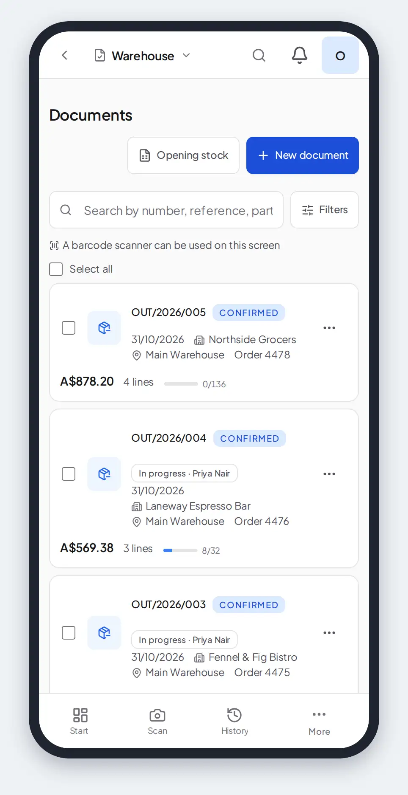

### 10.9 Configuration

**Warehouse → Configuration** has eight sections, listed down the left on a
wide screen and across the top on a phone: *Receiving and scanning*,
*Putaway*, *Printouts*, *Numbering and prices*, *Approvals*, *Work on the
floor*, *Tracking links* and *Ready-made setup*. Edits in several sections
wait for one **Save**: change what you need, move between sections, and save
once (the one exception is *Ready-made setup*, below, which saves at once).
Someone without the right to manage the module can read every section but not
change it.

- **Receiving and scanning** — the **Over-receipt tolerance**: how far past
  the expected quantity (or past what is left of an order line) a receipt may
  go without the **Receive over tolerance** permission — and the
  **Over-receipt ceiling**, which nobody passes with or without it. The same
  section holds the **Quarantine location**: the location a receipt line
  coded *Damage* or *Quality hold* is received onto when it has no batch to
  quarantine (10.3). It has to be an active location of your own. **Release
  an idle scanning session after (minutes)** sets how long a picking or
  receiving session nobody has scanned in keeps holding its document; after
  that, what was scanned is kept and anyone can continue it or complete the
  document.
- **Putaway** — receiving in one step or two, for each warehouse (10.6), with
  links to **Putaway rules**, **Occupancy** and **Codes and labels**.
- **Printouts** — the **Print layout** every document without a template of
  its own type prints with, and a link to **Print templates** for your own
  layouts per type.
- **Numbering and prices** — **Value tracking**: prices and tax on document
  lines (no tax, one rate per document or a rate per line), a default rate,
  the currency, and whether every line must have a price. **Tax rates** keep
  the organization's rates (*Add the country's rates* starts the table from
  the standard and reduced rates of the organization's country, where the
  application knows its law),
  and **Rates by category** names the rate a category's goods take. A
  product names its own rate in its edit form (**Tax rate**, saved at once).
  A new document or purchase-order line takes the product's rate, then its
  category's, then the default; a document with more than one rate shows the
  tax per rate under its totals and in print. Below it,
  **Partner requirements**: whether the partner must have a tax ID. Left
  untouched, the organization's country decides (Poland, France and Spain
  require it; Germany does not); a partner marked as a private person is never asked
  ([chapter 13](#13-partners-and-approvals)). The closed *Advanced* group
  holds the number format, its padding and the short name of each type
  (*Advanced: numbering format and document names*).
- **Approvals** — which document types wait for approval and from which value
  ([chapter 13](#13-partners-and-approvals)).
- **Work on the floor** — **Confirm the location by scan**: Scan picking and
  Scan receiving and put-away ask for the location's label before the product (10.3) —
  and the **Picking order**, the walk a picking session takes through the
  locations (10.3, *Pick path*).
- **Tracking links** — your own carriers' tracking pages: the carrier's name
  as you type it at completion, and a web address with `{tracking_number}`
  where the number goes, for example
  `https://example-courier.com/track?number={tracking_number}`. **Add a
  carrier** adds a row and the bin removes one; the list is saved with the
  rest by **Save**. A link of your own wins over the built-in one for the
  same carrier.
- **Ready-made setup** — *Simple*, *Poland — warehouse*, *United Kingdom —
  warehouse*, *Germany — warehouse*, *France — stock documents*, *Spain — stock
  documents* or *Full value tracking*. Picking one asks
  **Apply this preset?** and applies on **Apply**, with an **Undo** offered
  afterwards. It is saved at once, and it replaces document numbering and type
  labels, the default unit and the visible line fields, the print layout,
  value tracking, the tax mode and rate, the currency and whether a partner's
  tax ID is required — unsaved edits to those settings on the page are
  discarded. Approvals, receiving, putaway, floor work and tracking links
  stay as they are.

### 10.10 From pick to parcel

This is the whole path of goods through a small warehouse, one step after
another, with the section that has the details for each. Nothing in it is
compulsory beyond the documents themselves: a warehouse that does not pack or
ship with a carrier skips those steps, and the documents complete as before.

**Before the first order.** Give your locations a **Walk order** (10.3,
*Pick path*), so that a picking list follows the route through the building
rather than the alphabet. Print location labels (chapter 5) if you want the
scan sessions to check the location (**Confirm the location by scan**, 10.9).
The phone's camera works on every screen below; a USB or Bluetooth scanner
that types like a keyboard is supported too, without setup (chapter 4).

**1. Receive.** A confirmed receipt planned for today or earlier appears
under **To do** with a **Receive** button. **Scan receiving** counts the goods
in by scanning each pack. A product taken by earliest expiry asks for its lot
and expiry date on the first scan of its line, so it never arrives undated.
**Record received quantity** records a line that came short. Closing the
summary with **Complete and post stock** books the stock into the location each line is planned for (10.6), each
line at its own cost.

**2. Pick.** Confirmed deliveries planned for today or earlier wait under
**To do** with a **Pick** button. To pick several at once, tick them in the
documents list and choose **Pick N selected**: one walk collects the goods for
all of them, in walk order, and every line names the delivery it belongs to.
After several, **Close** on the summary leaves each of them picked and still
open, ready to pack; after a single one, the summary offers **Pack** beside
**Complete and book**, which completes it at once.

**3. Pack.** A picked delivery shows a **Packing** step on its page (10.4).
**Everything in one package** covers the common case in one tap; otherwise
add packages and fill them by scanning or tapping the lines, and weigh them if
you like. Each package has a code made of the document number and P1, P2, …,
printed as a barcode on its **Packing slip** and its **Label**.

**4. Ship.** **Complete dispatch** moves the stock. The **Carrier** and
**Tracking number** typed beside it are saved with the completion (10.5), and
the document then shows a **Shipment** card whose number links to the
carrier's tracking page. The **Register** lists carrier and tracking number
for the period, and a webhook on the `document.shipped` event can tell another
system that the parcel left (chapter 14).

What this path does not do yet: nothing groups deliveries into waves by route
or cut-off time, no carrier is contacted — the label from the carrier and its
tracking updates stay in the carrier's own system — and a customer's return is
a document written against the delivery (10.3, *Returns*) rather than a
process of its own.

### 10.11 Keeping records for an audit

A tax audit, a customs check or an auditor's sample asks the same questions
of any system that holds the records behind the books: can a record be
changed after the fact, how is a mistake put right, who did what, are the
numbers complete, and can the records be handed over. This page answers them
for Inventari so that a business can take it as the core of its own written
procedure description (in Germany, the *Verfahrensdokumentation*) and add
what is specific to it: who holds which role, where the exports are kept, how
long. It describes what the application does; it does not say what a given tax
authority accepts, which is for the business and its adviser to settle.

**What cannot be changed, and from when.**

- A **draft** is a plan. It can be edited, and deleted — a deletion is
  written to the audit log with the document's number.
- From **Confirm** on, a document is a record: its lines, quantities, prices,
  partner and dates can no longer be edited, and it can no longer be deleted.
  A confirmed or waiting document can be **cancelled**; a **completed** one
  cannot, and is put right with a correction (below).
- Two things stay open between Confirm and completion, because the work is
  not finished: on a confirmed receipt the shelf each line will land on can
  still be named or changed, and fields that a module adds to the document
  stay writable until it is completed. And a document that an approver
  **rejects** goes back to a draft (10.7), keeping its number, and can be
  edited again before it is confirmed anew. From **completion** on, nothing of the kind remains: only a
  correction changes the outcome.
- A **cancelled** document keeps its number and stays on record, and the
  document list shows it when filtered by status. Nothing deletes it.
- The partner's name, tax number and address, your own company's name, tax
  number and address, and the names of the locations the document refers to
  are copied onto the document when it is confirmed (the record of a closed
  stock take, which is written as done, takes them at that moment). Editing any of them later
  does not change a document already issued, and a reprint shows the values
  of the day it was confirmed; each line keeps the product name and the price
  it was written with. What a reprint still reads as it is today: the print
  template, the document type's settings (title, which columns show) and your
  logo. A document confirmed before this was recorded prints your company
  details and location names as they are now.
- The **audit log** cannot be edited or deleted by anybody, administrators
  included: the database itself refuses to change or remove a row. No timer
  deletes documents, movements or audit entries. Two timers do delete: the
  webhook delivery logs, kept 30 days unless the **Webhooks** settings name
  another period, and archived products, once an organization has set an
  archive retention period (none is set by default). No screen sets that
  period: it is the `archive_retention_days` key of the organization's
  settings, written through the API (`PUT /organizations`), and a product
  archived longer than that many days is then deleted for good, through the
  same checks as **Delete permanently**.

**Corrections.** A completed document is corrected with **New correction**
(10.3): a new document with a number of its own (`COR` in the default format),
which names the document it corrects, restates only the lines that change
with a signed quantity, and moves stock by the difference when it is
completed. Only quantities can be corrected, and a correction cannot take
more off a line than is still there. The original stays exactly as it was;
the two are read together. A correction is subject to the same period check
as any document.

**Closing a period.** **Period closure** closes a calendar month
(10.8). In a closed month no document can be created, edited, confirmed,
completed or cancelled, and no stock take can be completed. Closing and
reopening are each recorded with who did it, when, and the note typed at the
time, and the change appears in the audit log. Reopening is allowed because a
real mistake sometimes needs it; the record of it is what makes it safe, so
it is worth deciding who may close and who may reopen (**Access & Roles**).

**The audit log.** **Settings → Audit Log** (administrators only) lists who
did what to the organization's records: the person, or the API key — its
prefix is recorded — the time, what was done, to which record, and the values
before and after, with the names of the things referred to as they were called
at the time. Documents are logged when they are created
(a correction names the document it corrects) and at confirmation, approval,
completion, cancellation and deletion of a draft, and each package of a dispatch
when it is made, filled or removed; the entry carries the
number and, for a status change, the new status. Changes to products,
locations, templates, users, roles and settings are logged the same way.
Two limits are worth knowing. Where a document's own fields are edited, or a
module writes its fields on a document before completion, the log keeps the
names of the fields that changed, not the old and new values; status changes,
line destinations and the records listed above carry the values. And what a
person only looked at is not recorded. The movement journal (6, *Movements*) is the
second record: every change of stock, with the document or other source
behind it, and who did it.

**Numbering.** A document gets its number when it is confirmed, from a
counter kept for the number's prefix, the format with the sequence left out
(10.8). With the default format, `{TYPE}/{YEAR}/{SEQ:03d}`, that counts per
type and year; a format with `{MONTH}` in it counts per month, and one with
neither counts in one run for the type. There are no gaps made by drafts that
were thrown away. A number is unique within the organization and is never
reused or rewritten. A cancelled document keeps its number. The format can be
changed for future documents; earlier ones keep what they were issued under,
and a new prefix starts its own count.

**What can be handed over.**

| The auditor wants | Where it comes from |
|---|---|
| The documents, with totals, partner, status and date | **Document register** and **Export CSV** (10.8): the completed documents of the chosen period and type; the CSV has no row limit and carries no lines. Cancelled documents are not in it: they are on the document list, filtered by status, and in the audit log |
| One document with its lines, as printed | **Download PDF** on the document (see below), or the document's page on screen; several at once through the bulk **Download PDF** of the document list |
| Every movement of stock | **Movements → Export** (6): one spreadsheet of up to 50,000 rows (a larger result is refused, not cut short) with date, product, quantity, from and to, batch, source and person, for any filter the screen offers; its *Reference* column is the id of the document behind the movement, which joins to the page's link |
| Stock on a given day | **Stock on a date → Export** or **Print** (6) |
| Who did what | **Settings → Audit Log → Export CSV**: the page of entries the screen shows, under the filters chosen (person, API keys or people, kind of record, dates). It takes one page of 100 entries at a time, so a long range is exported in stretches |
| Read-only access for the auditor | An account whose role grants reading only (the built-in **Viewer**, or your own role with just the read permissions, **Access & Roles**) looks but changes nothing. Check in **Access & Roles** that the role reaches the screens the auditor needs; the audit log is for administrators only |

There is no single package that exports documents, lines, movements and log
together in a fixed machine-readable format; the exports above are separate
files, and the business should say in its own description which are produced
for an audit, by whom, and where copies are kept.

**Printouts are not stored.** A PDF is produced from the document's data when
you press **Download PDF**; Inventari does not keep a copy of what was
printed. The partner, your own company details (name, tax number, address),
the names of the shelves the document refers to and the lines are as they
were at confirmation and do not change. But the PDF also reads what is
current when it is made: the print template, the document type's settings
(title, whether prices and tax are shown) and your logo, from **Settings**.
A reprint can therefore differ in layout from the first print without the
document having changed; a document confirmed before the company details
were recorded with it shows them as they are now. A
business that must keep a delivery note or order *as sent* — because the law
treats it as a business letter, or the customer was sent a file — should save
the file at the moment it sends it (or keep the email it went out in) and
keep it with the rest of its records for the period its law requires. The
reasoning behind this is in
[ADR-025](adr/ADR-025-completed-documents-do-not-store-their-pdf.md).

**Keep in the business's own description** what the application cannot know:
who is authorized to confirm, close periods and read the log; how long records
are kept and on what media; the backup and restore routine (see
[DEPLOYMENT.md](../DEPLOYMENT.md)); and how the exports above are taken, dated
and stored when an audit is announced.

---

## 11. Purchase orders

**Purchase Orders → Create order**: the supplier (a draft can do without one),
the scheduled date, currency, notes and lines with quantity, unit, unit price
and VAT.

- **Confirm** needs an active supplier. Depending on the settings, the order
  may first need approval — **Request approval** sends it.
- **Send to supplier** emails the order as PDF to the supplier; **Download PDF**
  saves it.
- **Receiving.** On a confirmed order, **Receive delivery** opens **Receive
  goods** (chapter 10) with the order's lines already loaded: say what arrived
  and press **Receive into stock** — one press posts the receipt and moves the
  stock. A partial delivery is simply one receipt of several; the receipt is
  listed under **Linked receipts** on the order. The order is **Completed**
  when everything has been received.
- **Cancel order** is possible until something has been received.

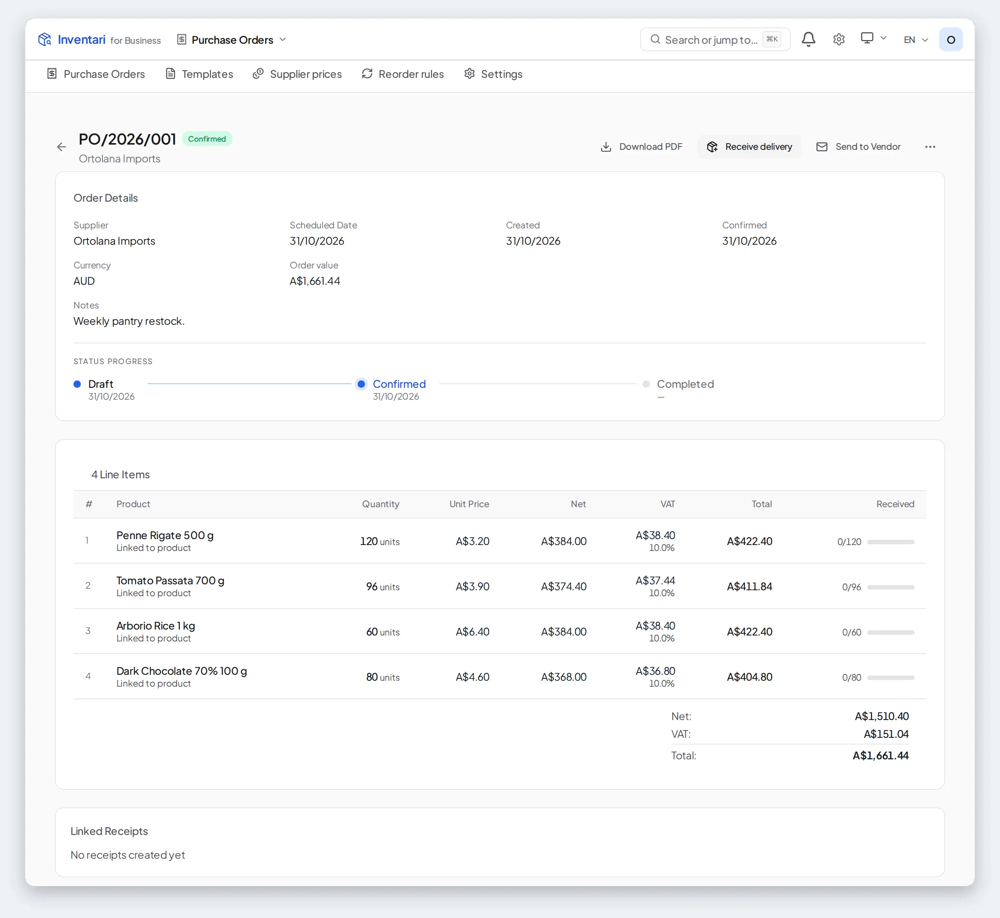

**Supplier prices** keeps each supplier's price per product, with a minimum
quantity and dates of validity, and compares suppliers. Warehouse documents suggest these
prices on their lines.

**Reorder rules** set a minimum and maximum per product and location, and a
preferred supplier. A shelf that only feeds the floor — a reserve rack — is
marked **Reserve location** on the location's **Settings** tab: stock there is drawn
from to fill pick faces and is never replenished from another shelf. When a pick
face falls below its minimum and the product stands on a reserve shelf of the
same warehouse, the alert proposes an internal move first — unreserved stock of
active batches, oldest batch first, from the reserve shelf holding the most — and
lists it on **To do** and the work board. **Replenish** opens the transfer with
its lines prepared; posting it moves the stock like any other **Move**, with a
shelf scan first where the document profile asks for one. **Create draft POs**
then covers only what reserve cannot, one draft order per supplier, for the
quantity that brings stock back to the maximum. Reserve is counted once: when
two pick faces of the same product are short, they share what the racks hold,
so the same carton is never promised to both and never bought twice. A move
that has not posted yet — still waiting for a signature, or already picked —
counts as promised, so the shelf is not asked for it again. Nothing is ordered
automatically.

**Settings** decide when an order needs approval: always, or above a net total.

---

## 12. Production

**Production** turns materials into products and tells you what each batch
cost.

### 12.1 Bills of materials

**Production → BOMs → New BOM**: the product it makes, a name and how much one
batch yields. The first BOM of a product becomes its **Default**.

- **Composition** — **Add ingredient**: the product, how much per batch, the
  unit, and under **More** a **Yield loss %** for what is lost along the way.
  **Multi-level view** shows BOMs used inside other BOMs. **Process steps**
  describe the work.
- **Cost & result** — the materials at what they cost you now, fixed costs per
  batch (labour, packaging, overhead), and a **reference price** to compare
  with: a shop price (*Savings vs shop price*) or your selling price (*Margin*), as set in
  **Settings**.
- **History** — the runs made from it.

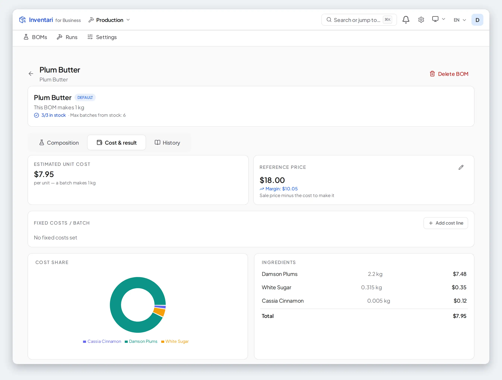

### 12.2 Making a batch

Start from a BOM card with **Produce**, or from **Runs → New production** (which
uses the product's default BOM). Enter the quantity and where the output goes.
**Preview cost** shows the cost before anything moves; the sheet then asks
*What are you recording?* — **Already made**, saved with **Save as made**, or
**Planning to make**, written with **Plan the run**.

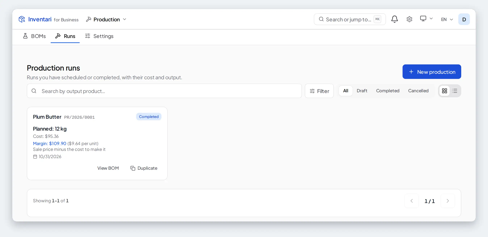

**Complete run** takes the materials off the shelves and puts the product into
stock at the target location. You may enter the quantity actually produced; the
materials used are always the full planned amount. A quantity above the plan is
refused unless **Allow overproduction** is on in the Production settings. The run's cost is what those
exact materials cost when they came in (FIFO), plus the fixed costs, and the
product enters stock at that cost per unit.

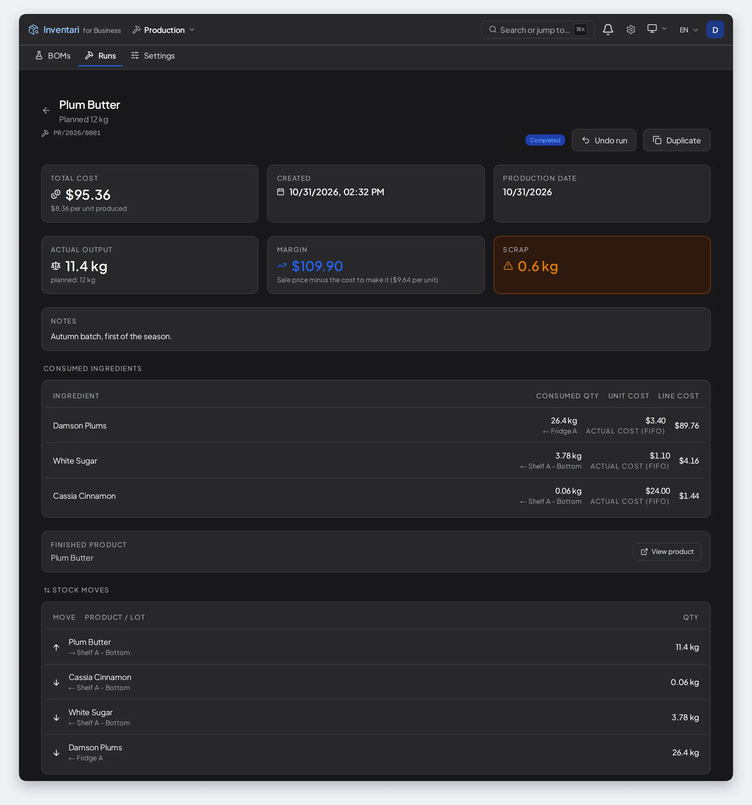

The ***result* by month** widget on **Production → BOMs** — named after the result you set in the Production module's settings — adds up, month by month, the
difference between the reference price and the real cost of everything you
made.

---

## 13. Partners and approvals

### Partners

**Partners** is the directory of suppliers, customers, partners that are both,
service providers, manufacturers and employees — with codes, tax IDs and contact details.
**New partner** adds one, **Import** reads XLSX or CSV. On the screen a partner is
deactivated rather than deleted. The API can also delete one outright
(`DELETE /partners/{id}`) while no open purchase order names it: the products,
documents and orders that named it then name no partner, a document already
confirmed keeps the details it copied, and the audit log keeps who the partner
was. Its details link to its warehouse documents and purchase
orders. Warehouse documents copy the partner's details when they are confirmed, so later
changes to the partner do not rewrite them.

An organization in Poland, France or Spain needs the partner's tax ID before a
document naming that partner can be confirmed — the country's law or business
practice asks it of businesses. German law asks for no recipient tax ID on a
delivery or a receipt, so a German organization confirms without one; it can
turn **Require partner tax ID** on in the document settings if it wants the
check. A private person has none: tick **Private person (consumer)** on the
partner and their documents confirm without it. The quick form that opens from a
document's partner field asks for the tax ID and the tick too, so a new customer
is ready without leaving the document. If a confirmation is refused, the message
names the partner and the three ways out: add the tax ID, mark the partner as a
private person, or turn off **Require partner tax ID** under **Partner
Requirements** in the document settings.

### Approvals

**Approvals → Workflows → Create Workflow**: what it applies to — documents,
purchase orders or equipment check-outs; who it applies to (everyone, or
chosen people and roles; submissions by anyone else go through without
approval); and its stages, each approved by a role or by named people.
**Approvals** (the dashboard) lists requests to **Approve** or **Reject**. Pending approvals also show in the launcher's
**To do**.

---

## 14. Settings and administration

**Settings** (the gear, or **Settings** in the avatar menu on a phone). Everyone
sees **General**, **My profile** and **About** — the version, the licence and
a link to the source code; the rest is for administrators.

- **General** — the organization's name, currency and time zone; the details
  printed on documents (tax ID, address, logo); and **People**: members and
  their roles, registration requests (the instance's superuser only),
  **Invite User** and issued invitations.
  Also whether products used by modules show in general lists, and whether
  permanent deletion is allowed. Changing the currency does not convert
  amounts already recorded.
- **My profile** — your name, the language the app speaks to you and your
  password.
- **My modules** — the one place that decides which modules the workspace
  shows. Changing the choice made at setup: **What will change** lists the
  modules to be switched on and off before you **Apply**; modules you switched
  on yourself are kept, and existing data is never overwritten. Every module
  that can stand alone has a switch worded **Show only** followed by its name:
  it narrows the whole workspace to that module and switches the others off,
  and turning it off again shows all of them.
- **Modules** — every module with **Activate** and **Deactivate**. Switching a
  module off hides its screens; its data stays.
- **Email** — the SMTP server for invitations, purchase orders and
  notifications, with **Send Test Email** and a list of mail that never
  arrived.
- **AI connections** — the AI providers Inventari may use (hosted services such
  as OpenAI, Anthropic, Gemini or OpenRouter, or a local model through Ollama,
  LM Studio or vLLM), with **Test connection**, and which connection serves
  *Read a product from a photo* and *Read a recipe from text*.
- **Audit Log** — every change, with filters and **Export CSV**.
- **Access & Roles** — the built-in roles (Administrator, Manager, Member,
  Viewer) and your own, with **Create role** and a list of permissions.
- **API Keys** (with its module on) — **Generate New Key** for scripts and other
  systems: a new key starts read-only; tick a write permission only if the key must
  change data (at most what you can do yourself), or choose **Printing only**
  for the print agent's queue (its blank-label modes need a key that reads
  products). Each key's permissions are
  listed beside it. A key is shown once and travels in the `X-API-Key` header.
- **Webhooks** (with its module on) — **Add webhook**: a URL, a signing secret
  and the events that call it, with delivery logs kept 30 days unless
**Log retention (days)** says otherwise.
- **Approvals** and **Statistics** — the settings of those modules.

---

## 15. Statistics

**Inventory → Statistics**:

- **Overview** — *Inventory Health Check*: what needs attention, what is running
  low and the estimated value; **Show detailed stats** for distribution by
  location and category, the expiry forecast and costs.
- **Analytics** — stock age and rotation, alerts (forgotten products, missing
  staples, things expiring or expired, low stock, price spikes), a spending
  forecast and purchase patterns.
- **Reconciliation** — a check that your stock agrees with its history: the
  shelf against the movement journal, and the cost history against the shelf.
  It runs by itself every six hours and tells administrators when the picture
  changes.

---

## 16. Key ideas

- **Product and record.** A *product* is a thing you keep — "Earl Grey Tea,
  Orchard & Oak". A *record* is a quantity of it in one location, with its own
  expiry date and price. The product list shows records; **In every location**
  shows all records of one product.
- **Batch.** Goods received together under one batch or serial number, tracked
  with their expiry date and state (chapter 6).
- **Reservation.** Stock held for a confirmed outgoing document. It is still on
  the shelf, but no longer available to others.
- **Movement.** Every change of location or quantity, kept in the movement
  journal.
- **Cost and FIFO.** Each receipt brings goods in at its own cost. Goods leave
  taking the oldest cost first; what remains is valued at the cost of what has
  not left yet.
- **Backorder.** A draft for the part of a document that did not arrive or ship.
- **Period.** A calendar month of documents, which can be closed to freeze it.
